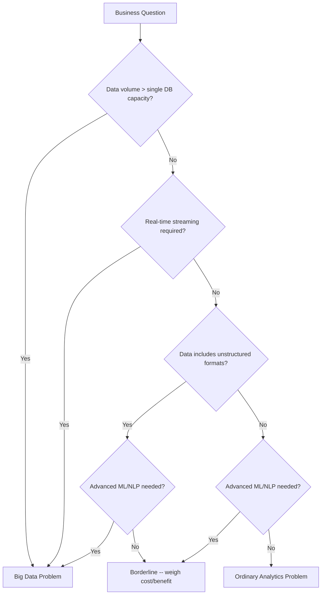
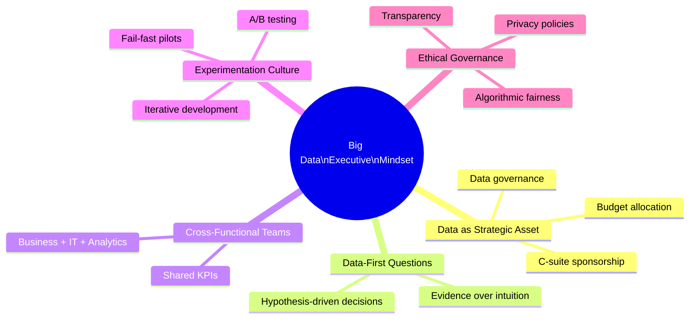

# Session 1: The Big Data Executive Mindset — Plain English

[Source: M1 S1]

---

## 1. What Is Big Data?

### In short
Big Data means datasets so large, fast, or messy that normal database tools (Excel, a single SQL server) can't handle them.

### Why does it matter?
Companies today collect data from everywhere — website clicks, sensors, social media posts, sales logs. The sheer volume and speed of that data overwhelms old-school tools. If you can make sense of it, you spot things that regular reports would never show you.

### How it works in practice
1. Data pours in nonstop from many sources (transactions, sensors, social media, system logs).
2. The amount, speed, or format is too much for a spreadsheet or a single database server.
3. You use specialised distributed systems (Hadoop, Spark, cloud data lakes) to store and process it.
4. Advanced techniques (machine learning, language analysis, graph analytics) pull patterns out of the stored data.
5. Those patterns become business decisions, automated actions, or new products.

### Analogy
Picture a small library where one librarian tracks 5,000 books in a paper ledger — works fine. Now that library gets 10 million books a day, in 50 languages, some handwritten, some on scrolls, some audio. The paper ledger is useless. You need a warehouse with automated sorting, multilingual staff, and transcription machines. Big Data is that shift — not because the ledger was broken, but because what's arriving has fundamentally changed.

### Real-world example
Walmart processes over 1 million customer transactions per hour, feeding databases of more than 2.5 petabytes. A regular SQL query on one server would take days. Walmart's Hadoop system answers the same question in seconds — for example, linking weather forecasts to product demand across 4,700+ US stores. [Supplementary illustration]

### Pros and cons
| Pros | Cons |
|------|------|
| Shows hidden patterns across huge datasets | Needs big infrastructure investment |
| Lets you make decisions in real time | Bad data spreads faster at scale |
| Creates a competitive edge | Hard to find people with the right skills |
| Personalisation at scale | More data = bigger privacy and ethics concerns |

### Why it matters for managers
Getting this right prevents two expensive mistakes: (1) not investing in analytics when you genuinely have a big-data problem, or (2) buying Hadoop clusters and hiring data scientists when a simple SQL query on your existing system would do the job. The executive mindset starts with correctly sizing the problem before picking the tool.

### Exam-ready definition
> Big Data means datasets so large, fast-moving, or structurally complex that traditional data tools can't process them, so you need distributed computing and advanced analytics.

---

## 2. Ordinary Analytics vs. Big Data Problems

### In short
Ordinary analytics problems can be solved with spreadsheets, SQL, or BI dashboards on medium-sized, tidy data. Big-data problems need distributed processing and involve data that's too big, too fast, or too messy for a single machine.

### Why does it matter?
Not every business question needs a big-data solution. Getting this wrong wastes money in both directions: treating a simple reporting need as a big-data project inflates costs; treating a genuinely complex, high-volume problem as a simple query means you miss insights and your system breaks.

### How to tell the difference
1. **Volume:** Can the data fit in one database or spreadsheet? If yes, it's probably an ordinary problem.
2. **Speed:** Does the data arrive in real-time streams that need instant processing? If overnight batch jobs are fine, it's ordinary.
3. **Format variety:** Is the data all neat rows and columns, or does it include text, images, video, sensor feeds? Mixed formats push toward big data.
4. **Analytical complexity:** Do you need simple sums and averages, or machine learning and language analysis?
5. **Rule of thumb:** If two or more of these (volume, speed, variety, complexity) go past what traditional tools handle, call it a big-data problem.

### Analogy
Cooking dinner at home: check the fridge, follow a recipe, use your stove — that's ordinary analytics. Catering a music festival for 50,000 people: hundreds of ingredients from dozens of suppliers arriving at different times, dietary needs you can't predict, meals served in real time while you adjust for weather and crowd size. The festival isn't "more cooking" — it needs completely different equipment, logistics, and staff. Same with big data vs. a bigger spreadsheet.

### Real-world example
**Ordinary:** A bakery chain with 12 stores tracks monthly sales in Excel to decide which pastries to drop. A few thousand rows of tidy data, analysed quarterly. A pivot table is all you need.

**Big Data:** Netflix analyses 100+ million viewing histories (petabytes of logs), mixing structured metadata, freeform reviews, and real-time streaming behaviour to recommend shows and decide what to produce. No single database or BI tool can do this at the speed and scale required. [Source: M1 S1, slide 2]

### Pros and cons
| Pros | Cons |
|------|------|
| Stops you from over-engineering simple problems | Needs some analytical maturity to classify correctly |
| Directs spending where it actually matters | The line between ordinary and big data isn't always clear |
| Saves money by matching tool to problem | Organisations may default to familiar tools and miss big-data opportunities |
| Builds a "diagnose first" culture | Can become red tape if you over-formalise the classification |

### Why it matters for managers
The most expensive analytics mistake is tool–problem mismatch. Spinning up a Spark cluster for a monthly sales report is like hiring a Formula 1 pit crew to change a bicycle tyre. Trying to build real-time fraud detection in Excel will fail badly. The executive move: diagnose the problem type before you commission a solution.

### Exam-ready definition
> Ordinary analytics problems involve structured, moderate-volume data solvable with traditional BI tools. Big-data problems involve data whose volume, speed, variety, or analytical complexity goes beyond what a single system can handle and needs distributed architectures.

---

### Visual: Decision Tree — Ordinary or Big Data?



**How to read it:** Start at the top. Follow the Yes/No branches based on your data. Include all four dimensions (volume, speed, variety, complexity) if reproducing for an exam. [Source: M1 S1, slide 2]

---

## 3. The Target Pregnancy Prediction Story

### In short
The US retailer Target used purchase-pattern analysis to figure out which customers were pregnant — and sent them baby-product coupons, sometimes before the customer had told their own family.

### Why does it matter?
Retail is fiercely competitive. Getting a new customer costs 5–7× more than keeping one. Life events like pregnancy trigger huge shifts in buying habits — a new parent might consolidate all their shopping at one store. If you can spot these moments early, you capture a much bigger share of the customer's spending.

### How it worked
1. Target's analytics team (led by statistician Andrew Pole) studied purchases by customers who had signed up for baby registries — known pregnancies.
2. They found about 25 products whose buying patterns changed predictably during pregnancy (e.g., unscented lotion, calcium/magnesium/zinc supplements, large handbags).
3. Every customer got a "pregnancy prediction score" based on how closely their recent purchases matched the pattern.
4. High-scoring customers got targeted marketing — baby-product coupons mixed in with unrelated items so the targeting didn't look obvious.
5. In one widely reported case, a father complained to a store manager about his teenage daughter getting baby coupons — then found out she was, in fact, pregnant.

### Analogy
Think of a neighbourhood shopkeeper who notices a regular customer buying ginger tea, crackers, and prenatal vitamins, and quietly guesses she's expecting. Target did the same thing, but computationally, across 100+ million customers at once, with mathematical precision instead of intuition. The controversy is the same too: a shopkeeper quietly noticing is one thing; a corporation algorithmically profiling intimate life events is quite another.

### Real-world example
Target's model reportedly brought in major revenue by reaching expectant parents early. But a 2012 New York Times piece by Charles Duhigg set off a public backlash, forcing Target to disguise the targeting by mixing baby-product coupons with random offers (lawn mowers, wine glasses). The case became a textbook example of the tension between analytical power and customer privacy. [Source: M1 S1, slide 3]

### Pros and cons
| Pros | Cons |
|------|------|
| Shows the power of predictive analytics for spotting life events | Raises serious ethical and privacy concerns |
| Proves the return on customer-level personalisation | Public backlash can hurt the brand |
| Illustrates that big data is about pattern recognition, not just volume | Predictions aren't perfect — false positives alienate people |
| Competitive edge even in mature, low-margin industries | Draws regulatory scrutiny (think GDPR) |

### Why it matters for managers
This case is the go-to example of why a big-data mindset must include ethical thinking, not just analytical skill. A manager needs to ask not only "Can we predict this?" but "Should we act on it — and if so, how?" Analytical power without governance creates reputational and regulatory risk.

### Exam-ready definition
> The Target pregnancy prediction case shows how a retailer used purchase-pattern analysis to predict customer pregnancies for targeted marketing — illustrating both the power of predictive analytics and the ethical risks of using personal data without clear consent.

---

## 4. Data-Intensive Business Models

### In short
A data-intensive business model is one where data isn't a side activity — it's the core of how the company makes money.

### Why does it matter?
Old-school businesses treat data as a by-product: useful for reports, but not central. The rise of digital platforms, IoT, and AI has created entire categories of business where data IS the product, or where data-driven insights are the main competitive weapon. If you're an executive navigating digital transformation, you have to understand this shift.

### The four types
1. **Data as Product:** You collect data and sell it (e.g., Bloomberg terminals, credit bureaus like Experian).
2. **Data as Platform:** You build a platform, attract users, collect their behavioural data, and make money through ads or marketplace fees (e.g., Google, Facebook, Amazon Marketplace).
3. **Data as Differentiator:** You're in a traditional industry but use data as your main competitive weapon (e.g., Zara's real-time supply chain, Uber's dynamic pricing).
4. **Data as Infrastructure:** You provide data tools and platforms to other businesses (e.g., AWS, Snowflake, Databricks).

### Analogy
Three restaurants. The first (traditional) is a family diner with good food and a simple cash register. The second (data as differentiator) is a chain that uses foot-traffic sensors, loyalty-card data, and weather APIs to predict demand and adjust menus daily — same business, but data transforms the operations. The third (data as product) doesn't serve food at all; it sells analytics dashboards to other restaurant owners. The food industry didn't change, but data created entirely new ways to make money in it.

### Real-world examples
**Google:** Doesn't charge users for search. Its revenue comes from auctioning ad placements using data about what you search for, where you are, what device you're on, and what you've browsed. Every search query is both a service to you and a data point that sharpens the ad engine. Revenue in 2023 topped $300 billion, overwhelmingly from data-driven advertising. [Supplementary illustration]

**Retail churn (Problem #1):** A retailer moving from a traditional model to a data-intensive one might deploy churn-prediction algorithms on transaction histories. Instead of reacting to lost customers with generic "come back" campaigns, the data-intensive approach flags at-risk customers before they leave and triggers personalised retention offers. [Source: M1 S1, slide 4]

### Pros and cons
| Pros | Cons |
|------|------|
| Builds hard-to-copy competitive moats (network effects, data flywheel) | Needs sustained infrastructure investment |
| Personalisation and efficiency at scale | A data breach can be existential |
| Opens new revenue streams (selling data or insights) | Regulations are tightening (GDPR, CCPA, AI Act) |
| Scales cheaply — serving one more user costs almost nothing | Garbage data in = garbage insights out, at scale |

### Why it matters for managers
Every MBA will face the question: "Is our business model data-intensive, or should it be?" The answer shapes hiring, technology investment, and org structure. If you can't tell the difference between using data for reports (ordinary) and building the business around data (data-intensive), you'll spend money in the wrong places and miss strategic openings.

### Exam-ready definition
> A data-intensive business model is one where data collection, processing, and analytics are the core way the company creates value — as opposed to traditional models where data plays a supporting role in reporting.

---

### Visual: Spectrum of Data Intensity

```
+-----------------------------------------------------------------------+
|                  SPECTRUM OF DATA INTENSITY                            |
+-----------------------------------------------------------------------+
|                                                                       |
|  LOW                    MEDIUM                    HIGH                 |
|  Data as               Data as                   Data as              |
|  By-product            Differentiator             Product/Platform    |
|                                                                       |
|  - Family bakery       - Zara supply chain       - Google Ads         |
|  - Local plumber       - Uber dynamic pricing    - Bloomberg Terminal |
|  - Corner shop         - Amazon recommendations  - Experian/CIBIL     |
|                                                                       |
|  Tools: Excel, POS     Tools: BI, ML pipelines   Tools: Data lakes,  |
|                                                   real-time ML,       |
|                                                   streaming platforms |
+-----------------------------------------------------------------------+
```

**How to read it:** Most organisations sit somewhere on this line. The executive challenge is knowing where your company is now and where it should move. For exams, draw it as a horizontal bar with three labelled zones and 2–3 example companies in each. [Source: M1 S1, slide 4]

---

## 5. The Big Data Executive Mindset

### In short
The Big Data Executive Mindset is a leadership stance: treat data as a strategic asset, push for decisions backed by evidence, understand the technology well enough to ask good questions, and balance ambition with ethics.

### Why does it matter?
Technology alone doesn't turn data into value — leadership does. Companies that spend millions on Hadoop and data scientists but lack executive sponsorship, data governance, and a testing culture consistently fail to get results. McKinsey (2016) found that only 8% of surveyed companies were actually good at deploying analytics at scale, and the main blockers were organisational, not technical.

### Five pillars
1. **Treat data as a strategic asset.** Give data quality and infrastructure the same budget and senior attention you'd give financial capital or talent.
2. **Ask data-first questions.** Before any major call, ask: "What data do we have? What do we need? What does it say?" — rather than defaulting to gut feel or precedent.
3. **Build cross-functional data teams.** Break the walls between IT, analytics, and business units. Data scientists who don't understand the business build useless models; business leaders who don't understand data make uninformed strategies.
4. **Create an experimentation culture.** Encourage A/B testing, pilots, and a fail-fast mentality. Big data thrives on iteration, not rigid long-term plans.
5. **Govern ethically.** Set policies for privacy, consent, algorithmic fairness, and transparency. The Target case shows what happens when analytical power runs ahead of ethical guardrails.

### Analogy
A general with the most advanced weapons but no strategy, no intelligence network, and no rules of engagement will lose the war. The Big Data Executive Mindset is the strategy and the rules of engagement. Hadoop is just the weapon. The armies that win aren't the ones with the best guns — they're the ones whose leaders know when to fire, where to aim, and when to hold back.

### Real-world example
Netflix's Reed Hastings didn't just fund a recommendation algorithm — he built a culture where every decision, from what content to buy to how to design the interface, was tested with data. When Netflix put $100 million into House of Cards (2013), the bet was backed by data showing that people who liked the original UK version also liked Kevin Spacey films and David Fincher's directing. This wasn't a data team's side project; it was an executive-level commitment to data-driven decisions. [Supplementary illustration]

### Pros and cons
| Pros | Cons |
|------|------|
| Aligns tech spending with business strategy | Cultural change is slow and hard |
| Cuts reliance on gut instinct for big decisions | A data-driven culture can over-focus on what's measurable and miss what isn't |
| Gets the organisation ready for AI and ML | Executive data literacy varies; training is needed |
| Builds customer trust through transparent data practices | Ethical frameworks are still evolving — no universal standard yet |

### Why it matters for managers
This is the single most important concept in the module because everything else depends on it. Without this mindset, the 5 Vs are just trivia, Hadoop is an expensive toy, and data science teams produce reports nobody reads. With it, even modest analytics can deliver real business value. Every topic in this course ultimately comes back to: does the leadership team treat data as a strategic asset?

### Exam-ready definition
> The Big Data Executive Mindset is a leadership orientation that treats data as a strategic asset, pushes for evidence-based decisions, builds cross-functional data capability, encourages experimentation, and governs data ethically — recognising that culture, not technology, is the main thing that makes big data work.

---

### Visual: Five Pillars of the Big Data Executive Mindset



**How to read it:** Five branches from a centre node. Each branch is necessary; none is enough on its own. For exams, draw it as a central circle with five spokes and list 2–3 sub-points under each. [Source: M1 S1, slide 5]

---

## 6. From Gut Instinct to Evidence-Based Decisions

### In short
Evidence-based decision-making (EBDM) means using the best available data and analysis — not just intuition, tradition, or anecdotes — to make business calls.

### Why does it matter?
Human gut instinct is powerful but systematically biased. Confirmation bias, anchoring, the availability heuristic — these lead managers into predictable errors. As companies generate more data, ignoring it in favour of a hunch gets more expensive. EBDM doesn't kill judgment; it backs it up with evidence.

### How to do it
1. **Frame the question.** What exactly are you deciding? What outcome do you want?
2. **Gather evidence.** Internal data (sales, operations, customer feedback) and external data (market research, competitor benchmarks, published studies).
3. **Analyse.** Apply the right method — could be a simple average, could be a machine-learning model.
4. **Add context.** Data doesn't speak for itself. Combine findings with industry knowledge, market conditions, and ethical considerations.
5. **Decide and act.** Make the call, document why, and set clear success measures.
6. **Measure and learn.** After you act, compare what actually happened to what you predicted. Feed the results back into your system.

### Analogy
A doctor who prescribes medication based on "I have a feeling this will work" is practising gut-instinct medicine. A doctor who checks lab results, reads clinical trial data, considers the patient's history, and then prescribes is practising evidence-based medicine. Both use judgment, but the second doctor's judgment is backed by data. The big-data executive mindset asks you to be the second doctor.

### Real-world example
Moneyball (2002): The Oakland Athletics, one of baseball's poorest teams, used statistical analysis of player data (sabermetrics) to find undervalued players that traditional scouts missed. By replacing gut-instinct scouting with evidence-based evaluation, the A's built a competitive team at a fraction of their rivals' cost. The approach has since spread across professional sports. [Supplementary illustration]

### Pros and cons
| Pros | Cons |
|------|------|
| Reduces bias in decision-making | Needs data literacy across the organisation |
| Creates repeatable, measurable decision processes | Data can be incomplete, biased, or stale |
| Organisations learn faster through feedback loops | Over-reliance on data can cause analysis paralysis |
| Builds accountability — decisions are documented and testable | Brand-new situations may have no historical data to analyse |

### Why it matters for managers
The shift from gut instinct to EBDM is the behavioural foundation of the big-data executive mindset. Technology gives you tools; EBDM gives you discipline. Managers who master it build organisations that learn faster, waste less, and adapt more quickly. This isn't about killing intuition — experience still matters — it's about making sure your instinct is checked against evidence before you act on it.

### Exam-ready definition
> Evidence-based decision-making (EBDM) is the systematic practice of using the best available data and analysis, combined with domain expertise and ethical judgment, to make business decisions — replacing sole reliance on intuition, tradition, or anecdote.

---

## Session 1 Summary

| Concept | Core Idea | Key Example | Exam Keyword |
|---------|-----------|-------------|-------------|
| Big Data | Data beyond traditional tool capacity | Walmart 2.5 PB | Scale, distributed |
| Ordinary vs. Big Data | Classify before you solve | Bakery vs. Netflix | Problem diagnosis |
| Target Case | Predictive analytics + ethics | Pregnancy prediction | Privacy, prediction |
| Data-Intensive Models | Data as core value mechanism | Google, Zara | Platform, differentiator |
| Executive Mindset | Leadership orientation for data | Netflix culture | Strategic asset, culture |
| EBDM | Evidence over intuition | Moneyball | Bias, feedback loop |
