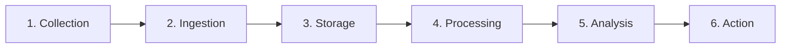
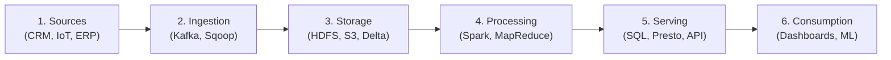

# Module 2 — Exam Questions (Plain English)

## 10-Mark Questions

### Q1. Describe the six-stage data lifecycle and explain how each stage creates or destroys business value. [10 marks]
[Source: M2 S3, slides 7–11]

**Model Answer** (800–1000 words)

The data lifecycle is the end-to-end journey data takes from the moment it is created to the moment it is used in a business decision. Executives need to understand it for one simple reason: value can be created or destroyed at every stage, and a failure at any single stage damages everything that comes after it.

**The six stages are:**

**1. Collection / Generation.** Data starts life in transactions, sensors, logs, user interactions, or external sources. Value is created when the right data is captured at the right level of detail — enough to answer a real business question, no more. Value is destroyed when important signals are never collected at all (customer feedback nobody asks for), when collection is incomplete (only 60% of stores report), or when consent and purpose are not documented. If you cannot show why you collected something, you have built a liability instead of an asset.

**2. Ingestion.** Data moves from source systems into the analytics environment through batch loads, streaming (a continuous flow of records), APIs (application programming interfaces — the standard way one system asks another for data), or file transfers. Value is created by timely, complete ingestion with schema validation, meaning every record is checked for the shape the pipeline expects. Value is destroyed by delayed loads (stale dashboards), dropped records (analytics that quietly miss 2% of sales), or ingestion without validation (garbage in, garbage out).

**3. Storage.** Data is kept in structured repositories (data warehouses), semi-structured stores (data lakes), or hybrid architectures (lakehouses). Value is created by matching the storage model to the way the data will actually be read, and applying sensible retention, classification, and security rules. Value is destroyed by storing everything forever (cost and exposure), by picking the wrong model (forcing SQL — Structured Query Language, the standard language for asking questions of structured data — analysts to query raw files), or by hiding data in systems people cannot reach.

**4. Processing.** Raw data is cleaned, transformed, enriched, and aggregated into analytics-ready datasets. This includes ETL (extract-transform-load: pull data out of the source, change it, then load the clean result into the target) or ELT (extract-load-transform: pull data out, load it raw first, then change it inside the target) pipelines. Value is created by consistent, tested transformations with clear ownership. Value is destroyed by undocumented transformations ("what did this formula do?"), inconsistent logic from team to team, or processing errors that propagate silently into every report downstream.

**5. Analysis.** Processed data is queried, visualised, modelled, and interpreted to produce insights. Value is created when analysts can self-serve trusted data, and when models are validated against baselines — a simple rule the model has to beat. Value is destroyed when analysts spend 80% of their time hunting for and cleaning data (a symptom of upstream failures), when insights rest on incorrect aggregations, or when models go into production without validation.

**6. Action / Consumption.** Insights drive business decisions — dashboards for executives, alerts for operations, scores for automated systems. Value is created when the insight reaches the right decision-maker in time to act on it. Value is destroyed when reports are ignored (insight, no action), when dashboards show contradictory numbers (no trust), or when automated decisions lack governance (no one is accountable when they go wrong).

**The value chain perspective:**

The data lifecycle becomes a value chain when each stage is managed with explicit ownership, quality standards, and measurable outputs. The value chain asks a harder question than the lifecycle does: at which stages is value actually created, and at which stages does it leak away? The slide material introduces "six value leaks" — the points where value is commonly lost. An executive should map the lifecycle for any data initiative, identify the owner at each stage, and ask: "Where is value most likely to leak, and who is accountable for preventing it?"

The cost curve and the value curve do not move together, and this is the part worth memorising. Spend starts low at Collection (instrumentation and sensors), rises at Ingestion (transfer infrastructure, connectors, landing zones), peaks sharply at Processing (reported at 60–80% of analytics effort), and stays high at Analysis (compute, tooling, data science salaries). Value, though, stays at zero until Action, where the insight finally changes a decision. After that, the outcome of the action comes back as new data, which compounds the value of every later cycle.

Two consequences follow. First, most data projects feel expensive and unproductive because the organisation has invested heavily in stages 1–5 and has no mechanism to turn the output into a decision at stage 6 — the cost curve climbed for six years while the value curve stayed flat at zero. Second, the stage where value is actually banked — Action, along with the outcome capture that follows it — is the one most often owned by nobody, which makes the unclosed feedback loop the most dangerous gap in the chain.

**Conclusion:** The six-stage lifecycle is not just a technical sequence — it is a management framework. Every data investment can be evaluated by asking whether each stage has a named owner, quality standards, and measurable outputs. A brilliant model (stage 5) built on poorly ingested data (stage 2) destroys value rather than creating it.

**Bottom line:** The six stages give you a fixed checklist for every data initiative. Find the stage where value leaks, name the owner of that stage, and fix it first — the whole chain is only as strong as its weakest link.

---

### Q2. Explain the six-layer big data reference architecture. For each layer, state its function and give one example technology. [10 marks]
[Source: M2 S4, slides 22–28]

**Model Answer** (800–1000 words)

The six-layer reference architecture — a fixed, agreed blueprint for how data flows from where it is born to the business decision that uses it — is the standard way to describe how data moves through a big data environment. Each layer has one clear job. Knowing the layers lets an executive read an architecture diagram, ask the right questions, and spot gaps quickly.

**Layer 1 — Sources.** The systems and devices that generate data: transaction systems, CRM (customer relationship management — the system holding customer records), ERP (enterprise resource planning — the system holding finance, HR, and supply chain records), IoT sensors (physical devices that report back over the internet), social media APIs, and external data providers. The analytics team does not design this layer — it already exists. The executive question: "Which sources do we have, which do we need, and what is the quality of each?"

**Layer 2 — Ingestion.** Moves data from sources into the analytics environment. Technologies: Apache Kafka (streaming ingestion — a message bus that keeps a continuous flow of records moving between systems), Apache Sqoop (batch transfer from databases), Apache Flume (log collection), and cloud-native connectors. The executive question: "How quickly does data arrive, and what happens when a source is late or broken?"

**Layer 3 — Storage.** Keeps data for processing and analysis. Options include HDFS (Hadoop Distributed File System — a distributed store for very large files), cloud object stores (S3, Azure Blob, GCS), data warehouses (Snowflake), data lakes, and lakehouses (Delta Lake on Databricks). The executive question: "Can this storage model handle our current volume and 10× growth?"

**Layer 4 — Processing.** Turns raw data into analytics-ready datasets. Batch processing (Spark, MapReduce) handles periodic analysis — you process a whole dataset at once. Stream processing (Spark Streaming, Kafka Streams) handles real-time work, where results come back in seconds. The executive question: "Is the processing fast enough for the decision it supports?"

**Layer 5 — Serving.** Exposes processed data to consumers through query engines (Spark SQL, Presto/Trino, Hive), APIs, and caching layers. The executive question: "Can our analysts query this without engineering help?"

**Layer 6 — Consumption.** Business users work with the data through dashboards (Power BI, Tableau), reports, embedded analytics, or automated decision systems (ML scoring APIs). The executive question: "Does the right person see the right insight in time to act?"

**Four cross-cutting concerns run through every layer.** They are not a seventh layer bolted on at the end:
- **Governance and security**: access control, data classification, privacy, audit trails.
- **Metadata, catalogue, and lineage**: what data exists, where it came from, how it was transformed.
- **Cost and FinOps**: storage, compute, egress, licensing, migration, skills, and exit costs.
- **Reliability and SLAs**: uptime, recovery, freshness guarantees, and incident response.

A proposal that treats security as a final step, or cost as an afterthought, is structurally defective no matter how good its processing engine looks.

**Batch path vs real-time path:**

The same six layers support two paths. The batch path loads data periodically (hourly, daily), processes it in bulk, and serves it for retrospective analysis — good for monthly reports and trend analysis. The real-time path ingests data continuously through streaming, processes it in micro-batches or one event at a time, and serves it for immediate action — good for fraud alerts, operational dashboards, and real-time personalisation.

Most organisations need both paths. The architecture decision is which decisions genuinely require real-time data (higher cost, higher complexity) and which can tolerate batch latency (lower cost, simpler).

**Managerial dependencies:**

Each layer depends on the one below it. A brilliant dashboard (layer 6) is useless if the serving layer cannot handle the query load (layer 5). A fast query engine is wasted if the processing pipeline produces stale data (layer 4). An executive reading an architecture diagram should trace data from source to consumption and ask: "What is the weakest layer, and what happens when it fails?"

Dependencies run downstream only, which makes the highest-leverage investment the one that is least visible and least exciting. If the source layer has a capture gap, no processing engine can manufacture the missing data — the ceiling is permanent. If ingestion fails silently, the most sophisticated dashboard shows wrong numbers confidently, and "sometimes right" is worse than visibly broken because decisions get made on data that looks complete. If storage has no retention policy, cost compounds monthly and compliance exposure grows invisibly until an audit, a breach, or an invoice makes it visible. If processing has undocumented business rules, the numbers cannot be explained to a regulator, a board, or an auditor. If serving has no single metric definition, every meeting starts by arguing about whose number is right rather than deciding what to do. If consumption has no named owner or cadence, the whole chain above delivers zero realised value because nobody acts on the output.

**Conclusion:** The six-layer architecture gives executives and engineers shared vocabulary. It lets you evaluate any big data initiative in a structured way: identify which layers exist, which are missing, and which one is the bottleneck.

**Bottom line:** The six layers are a checklist you can apply to any architecture diagram or proposal. Name the layer you are weakest at and fix it first — a strong layer on top never rescues a broken one underneath.

---

### Q3. Compare data warehouses, data lakes, and the modern lakehouse. When should an organisation choose each? [10 marks]
[Source: M2 S5, slides 33–45]

**Model Answer** (800–1000 words)

Three storage architectures serve different analytical needs. Any platform decision starts with knowing their trade-offs.

**Data Warehouse:**
A data warehouse stores structured, pre-processed data using a schema-on-write approach — data is cleaned, validated, and organised into a defined schema (a fixed set of columns and rules) before it is loaded. Technologies include Snowflake, Amazon Redshift, Google BigQuery, and traditional systems like Teradata.

Strengths: fast SQL queries, strong consistency, excellent for BI (business intelligence) dashboards and regulatory reporting. The data is clean and trusted because it was validated on entry.

Limitations: the rigid schema makes adding new data types slow; it is expensive to store large volumes of raw or semi-structured data; and it is not designed for data science workloads that need access to raw data.

**Data Lake:**
A data lake stores raw data in its native format using a schema-on-read approach — structure is applied when the data is queried, not when it is loaded. Technologies include HDFS, Amazon S3, Azure Data Lake Storage.

Strengths: stores any data type (structured, semi-structured, unstructured) at low cost; supports data science and exploratory analysis; scales to petabytes.

Limitations: without governance it becomes a "data swamp" — data is stored but nobody knows what it means, who owns it, or whether it is reliable. Query performance is weaker than a warehouse for SQL workloads. No ACID transactions (all-or-nothing database transactions that leave the data in a consistent state) in native form.

**Modern Lakehouse:**
A lakehouse combines the low-cost, flexible storage of a data lake with the data management and query performance of a warehouse. Technologies include Delta Lake (on Databricks), Apache Iceberg, Apache Hudi, and Snowflake's hybrid architecture.

Strengths: ACID transactions on lake storage; one architecture for both BI and data science; schema enforcement with flexibility; time travel (querying an earlier version of the data) and versioning; cost-effective for large volumes.

Limitations: newer technology — the ecosystem is maturing but not yet at warehouse levels; it needs people who understand both lake and warehouse thinking; and proprietary implementations carry vendor lock-in risk.

| Dimension | Warehouse | Lake | Lakehouse |
|-----------|-----------|------|-----------|
| Schema | On write (rigid) | On read (flexible) | Enforced but flexible |
| Data types | Structured only | Any (raw) | Any with schema support |
| ACID transactions | Yes | No (native) | Yes |
| Query speed (SQL) | Fastest | Slowest | Near-warehouse |
| Cost per TB | Highest | Lowest | Medium |
| Best for | BI, reporting, compliance | Data science, raw storage | Unified analytics |
| Governance risk | Low (enforced) | High ("data swamp") | Medium (requires discipline) |

**When to choose each:**

- **Warehouse**: when the main use is SQL-based BI and reporting, the data is structured, and strong governance is non-negotiable (financial reporting, regulatory compliance). Typical platforms: Snowflake, Amazon Redshift, Google BigQuery. It also suits teams with a mature BI team that thinks in SQL and uses tools like Tableau, Power BI, or Looker.
- **Lake**: when the main use is data science and exploration, the data is diverse (logs, images, sensor streams), and cost must be minimised for large volumes. It also suits the case where schema requirements are not yet defined and you are collecting data now to analyse later — but only if you already have governance processes in place to stop the lake becoming a data swamp, and data engineers comfortable with Spark and schema-on-read workflows. Typical platforms: Amazon S3 + AWS Glue, Azure Data Lake Storage, Google Cloud Storage + Dataproc.
- **Lakehouse**: when you need both BI and data science on the same data, want to avoid running two separate systems with fragile ETL between them, and can invest in the governance layer that makes a lakehouse trustworthy. It also suits mixed structured and unstructured data, and gives you time travel, versioning, and reproducibility for ML experiments and regulatory audits. Typical platforms: Databricks Lakehouse (Delta Lake), Snowflake (Iceberg support), Google BigLake, AWS Lake Formation + Athena.

**The hybrid reality:** these architectures are not mutually exclusive. Many enterprises run a dedicated warehouse for mission-critical BI reporting — where sub-second latency on complex joins is non-negotiable — alongside a lakehouse for broader analytics, ML, and data science. They sit on a spectrum, and the lakehouse is converging toward the middle.

**Business example — Healthcare (Problem #4):** A hospital system needs structured EHR tables for regulatory reporting (warehouse capability) and unstructured clinical notes for readmission risk modelling (lake capability). A lakehouse consolidates both in one architecture, with ACID transactions ensuring consistency.

**Conclusion:** The trend is toward lakehouses, but the choice depends on the organisation's primary use case, existing skills, and governance maturity. A warehouse for compliance, a lake for exploration, a lakehouse for unified analytics.

**Bottom line:** Use the warehouse for compliance and trusted BI, the lake for cheap raw storage and data science, and the lakehouse when you need both on one copy of the data. Whatever you pick, governance decides whether it stays useful or quietly turns into a data swamp.

---

### Q4. Describe the data value chain concept. How does it differ from the data lifecycle, and why is the distinction important for executives? [10 marks]
[Source: M2 S3, slides 7–12]

**Model Answer** (800–1000 words)

The data lifecycle describes the sequential stages data passes through — collection, ingestion, storage, processing, analysis, and action. The data value chain extends the idea by asking a different question: at which stages is value created, and at which stages does it leak away or get destroyed?

**The lifecycle is descriptive; the value chain is diagnostic.** The lifecycle tells you what happens to data. The value chain tells you where money is being made or lost. An executive needs both: the lifecycle to understand the technical flow, and the value chain to make investment and governance decisions.

**Six value leaks:**

The faculty material identifies common points where value is lost:

1. **Collection gaps** — important signals are never captured. A retailer tracks purchases but not browsing behaviour, so it misses the intent data that predicts future purchases.
2. **Ingestion delays** — data arrives too late for the decision it should inform. A fraud alert built on yesterday's transactions cannot prevent today's fraud.
3. **Storage mismatches** — data is stored in a format that blocks the intended analysis. Unstructured data sitting in a rigid warehouse cannot be queried by data scientists.
4. **Processing errors** — undocumented transformations introduce errors that propagate into every downstream report.
5. **Analysis misuse** — analysts spend 80% of their time finding and cleaning data, leaving little for real insight generation.
6. **Action failure** — insights are generated but never reach a decision-maker in time, or the organisation has no process to act on them.

**The diagnostic lens:**

The faculty material gives a practical approach: for any data initiative, trace the intended value from source to decision, and ask at each stage: "Who owns this stage? What is the quality standard? What happens when it fails?" Stages without answers are where value will leak.

**Why the distinction matters for executives:**

A CTO presenting a new data platform will describe the lifecycle — what the system does. An executive should respond with the value chain — where the investment creates returns. A platform that ingests data perfectly (lifecycle: working) but stores it in a format analysts cannot query (value chain: leaking at storage) is a cost, not an investment.

The cost-value asymmetry is the key insight. Spend starts low at Collection (instrumentation and sensors), rises at Ingestion (transfer infrastructure and connectors), peaks sharply at Processing (cleaning, reconciling, and standardising — reported at 60–80% of analytics effort), and stays high at Analysis (compute and data science salaries). Value, though, stays at zero until Action, where the insight finally changes a decision. After that, the outcome of the action comes back as new data, which compounds the value of every later cycle. This is why so many data projects feel expensive and unproductive: the organisation has invested heavily in stages 1–5 and has no mechanism to convert the output into a decision at stage 6. The retailer in the faculty material is the clean example — six years of perfect capture and storage, a spotless IT audit, and zero business value because Preparation was never funded, so the chain stalled at stage 3.

There is a second asymmetry that matters just as much: ownership. The stage where value is actually banked — Action, along with the outcome capture that follows it — is the one most often owned by nobody. That is the most dangerous gap in the whole chain, because nothing in the org is accountable for closing the loop.

Mapping the six stages to cost and value makes the pattern concrete:

| Stage | Cost Trend | Value Realised | Who Typically Owns It |
|-------|-----------|----------------|----------------------|
| 1. Collection / Generation | Low–moderate (instrumentation) | None yet | Source system owners, IT |
| 2. Ingestion | Moderate (transfer infrastructure) | None yet | Data engineering |
| 3. Storage | Moderate (keeping and securing data) | None yet | Data engineering |
| 4. Processing | Highest (60–80% of effort) | None yet | Data engineering, business analysts |
| 5. Analysis | High (compute, data science) | Potential visible, not captured | Data science, analytics team |
| 6. Action / Consumption | Low–moderate (workflow integration) | Value realised | Business decision-maker |
| Feedback | Low (outcome capture) | Compounds future value | Often nobody — the most dangerous gap |

Read the ownership column against the cost column and the diagnosis is obvious. The organisation spends most at Processing, and typically has no named owner for the stage that actually banks the value — Action.

One note on vocabulary, since the slides use two names for the same six steps: the slide material frames them as Creation, Acquisition, Preparation, Analysis, Action, and Feedback, while the exam's lifecycle calls them Collection, Ingestion, Storage, Processing, Analysis, and Action. Collection is Creation, Ingestion is Acquisition, and the exam's Action stage covers both Action and Feedback.

The opportunity diagnosis framework from Session 3 turns this into practice: before investing in a big data initiative, map the value chain from data to decision, identify the weakest stage, and focus investment there.

**Conclusion:** The lifecycle is the engineer's view; the value chain is the executive's view. Both describe the same flow, but the value chain explicitly links each stage to business outcomes and investment priorities.

**Bottom line:** The lifecycle tells you what the system does; the value chain tells you what it earns. Before approving a data investment, find the leaking stage, name its owner, and put the money there first.

---

### Q5. Explain the batch and real-time processing paths through the reference architecture. When should an organisation use each? [10 marks]
[Source: M2 S4, slides 29–30]

**Model Answer** (800–1000 words)

The six-layer reference architecture supports two processing paths. They use the same layers but differ in timing, cost, and complexity.

**Batch path:**
Data is collected over a period (hourly, daily, weekly), loaded in bulk, processed as a complete dataset, and served for retrospective analysis — looking back at what already happened. Batch is the default for most analytics.

Characteristics: high throughput, lower cost per record, simpler error handling (if it fails, reprocess the whole batch), and latency measured in hours. Suitable for monthly reports, trend analysis, model training, and regulatory filings.

Example: a retailer loads daily transaction data overnight, processes it into customer segments, and refreshes the executive dashboard each morning.

**Real-time path:**
Data is ingested continuously through streaming (Kafka, event hubs), processed in micro-batches or one event at a time, and served immediately for operational decisions. The real-time path is chosen when the decision cannot wait.

Characteristics: low latency (seconds to minutes), higher cost per record, more complex error handling (late arrivals, out-of-order events), and always-on infrastructure. Suitable for fraud alerts, operational monitoring, and real-time personalisation.

Example: a bank ingests card transactions via Kafka, scores each one for fraud in near-real time, and routes suspicious transactions to an analyst dashboard within seconds.

| Dimension | Batch | Real-Time |
|-----------|-------|----------|
| Latency | Hours | Seconds–minutes |
| Cost per record | Lower | Higher |
| Complexity | Simpler | More complex |
| Error handling | Reprocess batch | Handle late/out-of-order events |
| Infrastructure | Periodic | Always-on |
| Best for | Reports, training, compliance | Alerts, monitoring, personalisation |

**The decision framework:**

The faculty material advises: not every decision genuinely needs real-time data. The executive question is: "If this decision is made with data that is one hour old instead of one second old, what is the cost of that delay?" If the answer is "negligible," batch is the right choice. If the answer is "a fraudulent transaction goes through" or "a machine continues operating dangerously," real-time is justified.

There is a sharper way to put it: does this decision expire before the next batch run? A monthly financial close needs complete, reconciled data, and freshness measured in days is fine. A fraud alert on a card transaction needs a decision in seconds — waiting for the nightly batch means the money is already gone. The choice is made per decision, not per company.

Most organisations need both paths, usually running them over shared storage and governance layers so the same lake holds both batch-loaded history and stream-appended live events. The architecture decision is not batch OR real-time, but which decisions fall into which path. Over-investing in real-time for batch-appropriate decisions wastes money; under-investing for genuinely real-time needs loses business value.

One useful analogy: a daily newspaper versus a breaking-news alert on your phone. The newspaper is complete, edited, fact-checked, and cheap; the alert arrives within minutes but may need correcting later. You keep both, because a considered analysis and a fast alert serve different purposes. The predictive maintenance case shows the same split: the streaming path carries sensor events continuously so a dangerous deviation detected at 2pm triggers a work order by 3pm, while the batch path carries maintenance history through nightly processing to give the anomaly model the context it needs. Neither path alone is enough — streaming without batch context produces false alarms, and batch without streaming misses time-critical events.

The error to avoid is treating streaming as an upgrade on batch. It is not. It costs more, it is more complex, and it is harder to operate and debug. Most mature architectures run both paths over shared storage and governance layers, so the same lake holds both batch-loaded history and stream-appended live events. Running both does add architectural complexity, and that is the trade-off you accept for matching each decision to the right path.

The two paths also differ in the kind of work they do well, not just in speed. Batch suits decisions on a reporting calendar — the financial close, the weekly churn report. The streaming path suits individual events that cannot wait — a fraud alert, an IoT anomaly, a stock-price trigger. Batch gives you completeness, reconciliation, and a low cost per record; streaming gives you freshness on a single event, at a higher cost per record and with harder debugging.

The cost gap is worth remembering for budget conversations: batch runs on scheduled windows and stops when the job finishes, so you pay for compute only while the job runs. Streaming needs infrastructure always on, ready for the next event at any hour. That fixed cost is why "we'll go real-time" needs a business case, not just a technical one.

**Conclusion:** Batch and real-time are not competing architectures — they are complementary paths through the same reference architecture, chosen based on the cost of latency for each specific decision.

**Bottom line:** Real-time is a cost you buy on purpose, not a default setting. For every decision, price the delay — if an hour of lag does no harm, stay in batch and save the money.

---

## 5-Mark Questions

### Q1. What is a data lakehouse and how does it combine the strengths of warehouses and lakes? [5 marks]
[Source: M2 S5, slides 38–42]

**Model Answer** (400–500 words)

A data lakehouse is a storage architecture that combines the low-cost, flexible storage of a data lake with the data management features of a data warehouse — ACID transactions (all-or-nothing changes that keep data consistent), schema enforcement, and governance — in one unified system.

A traditional data lake stores raw data cheaply but lacks transactions, consistency guarantees, and strong governance, which leads to the "data swamp" problem: data is stored but nobody knows what it means or whether it can be trusted. A warehouse gives you governance and performance, but at higher cost and for structured data only. Organisations running both end up maintaining two copies of the data with complicated synchronisation between them.

The lakehouse solves this by adding a transactional metadata layer (such as Delta Lake, Apache Iceberg, or Apache Hudi) on top of lake storage (S3, ADLS, GCS). That layer provides ACID transactions (reads stay consistent even while writes are happening), schema enforcement (data is validated before it enters curated zones), time travel (you can query historical versions of the data), and audit capabilities.

Technologies: Delta Lake on Databricks is the most prominent lakehouse implementation. Snowflake's hybrid architecture also provides lakehouse capabilities. Both support SQL-based BI and data science workloads on the same data.

The business value: one platform for reporting analysts and data scientists, a lower total cost than maintaining a separate warehouse plus lake, and governance features that stop the data swamp from forming. It also gives you time travel, versioning, and reproducibility — useful when an auditor asks what the data looked like on a particular date, or when a data scientist needs to rerun an experiment on last month's data.

The governance point deserves a second look, because it is where most lakehouse decisions are won or lost. A lakehouse does not give you governance for free — it gives you the ability to have it. The metadata layer can enforce schema, track lineage, and record every commit, but someone still has to set the rules and own them. A lakehouse with no governance discipline is still a data swamp; it just has better tooling for storing one.

**Bottom line:** The lake is cheap but loose, the warehouse is safe but rigid, and the lakehouse tries to be both at once. That is why it has become the default choice for new cloud data platforms, and the one to argue for whenever the business needs BI and data science working on the same copy of the data.

---

### Q2. Describe the opportunity diagnosis framework from Session 3. What are its key steps? [5 marks]
[Source: M2 S3, slides 13–15]

**Model Answer** (400–500 words)

The opportunity diagnosis framework is a structured method for deciding whether a business situation is a genuine big data opportunity before you commit resources. It prevents the classic executive error: buying the technology first and validating the business case later.

Key steps:

1. **Identify the decision** — what business decision changes if this data is available? If no decision changes, there is no opportunity.
2. **Map data sources** — what data is needed, where does it come from, and what is its quality? Separate the data you already have from the data you must acquire.
3. **Assess data characteristics** — apply the 5 Vs (Volume, Velocity, Variety, Veracity, Value) to see whether this genuinely needs big data capabilities or could be solved with traditional analytics.
4. **Estimate value** — quantify the business impact of better decisions: revenue uplift, cost reduction, risk mitigation, or compliance.
5. **Identify risks** — technical risks (data quality, integration complexity), business risks (adoption, change management), and governance risks (privacy, security).
6. **Recommend** — proceed, pilot, or do not invest, and back the call with evidence.

Step 1 does the most work. If you cannot name the decision that will change, the other five steps have nothing to measure against. Most proposals fail at step 1 or 2, because they begin with the data they happen to have ("we have five years of clickstream") rather than with a decision that is being made badly.

The deliverable is the **opportunity statement** — one paragraph, not a business case document. The template runs: "For [the decision-maker] who must decide [the decision and cadence], we will combine [the data sources] to produce [the analytical output], enabling [the action], worth approximately [the value], provided [the assumptions and risks]."

A completed example from the faculty material: "For the Regional Retention Head, who must decide which customers receive a retention offer each week, we will combine six years of POS (point-of-sale) transactions, the loyalty master, and app clickstream to produce a weekly churn-risk score with the top three drivers per segment, enabling a targeted offer to the highest-risk 5% of active customers, worth approximately the retained margin on 1 in 5 of those customers, provided loyalty and app identities can be reconciled."

Four things make that statement survive scrutiny: a real owner (a named role with authority), a real cadence (weekly, so the refresh rate is defined), a real threshold (top 5%, so the model output has an operational cut-off), and a real risk (identity reconciliation is named, not hidden). If the team cannot fill in every bracket, the project is not ready for funding — it is ready for more diagnosis.

The framework is assessed directly in IA 1 (Session 9, 20 marks), where students must submit a value logic, data-source map, and risk note for a specific business situation.

**Bottom line:** Always name the decision first. If no business decision changes, there is no big data opportunity to invest in.

---

### Q3. What are the "six value leaks" in a data value chain? [5 marks]
[Source: M2 S3, slides 12–13]

**Model Answer** (400–500 words)

The six value leaks are the common points where business value is lost along the data lifecycle. Each one sits at a specific stage and has its own signature:

1. **Collection gaps** — important data is never captured (customer intent signals ignored).
2. **Ingestion delays** — data arrives too late for the decision it should inform.
3. **Storage mismatches** — data is stored in a format that prevents the intended analysis.
4. **Processing errors** — undocumented transformations introduce silent errors.
5. **Analysis waste** — analysts spend most of their time finding and cleaning data, not generating insight.
6. **Action failure** — insights are produced but never reach a decision-maker in time, or no process exists to act on them.

Each leak has a distinct fix, and diagnosing the right one is the whole skill:
- A capture gap cannot be fixed downstream. If the field was never recorded, no processing, model, or vendor can recover it.
- Transfer lag is fixed by matching transfer frequency to decision cadence.
- Quality loss is fixed by funding identity resolution and agreeing business definitions.
- Question drift is fixed by starting from the decision and working backward.
- No owner is fixed by naming one person who will act — or by stopping the project.
- An open loop is fixed by defining the outcome field before launch.

The leaks can also compound. In the retail churn case, the primary leak was quality loss at Processing (identity reconciliation failure), made worse by an open loop at Feedback (no mechanism to record whether the retention offer worked). Fixing model accuracy at the Analysis stage would have improved nothing, because the chain was already broken two stages earlier.

Two habits separate managers who use this framework from those who do not. The first is asking which leak a proposal closes rather than whether the model looks good. The second is accepting that leaks can co-occur, which makes root-cause diagnosis harder — a project with a broken pipeline and no named owner has two problems, and fixing only one changes nothing.

The diagnostic approach: for any data initiative, trace value from source to decision. At each stage ask: who owns this stage, what is the quality standard, and what happens when it fails? Stages without answers are where value will leak. The faculty workshop habit is blunt and worth quoting: before approving any data initiative, ask which of these six leaks the proposal actually closes.

**Bottom line:** The six leaks always sit at one of the six lifecycle stages, and a stage with no owner is a leak waiting to happen. Name the owner of every stage before you trust the data.

---

### Q4. Explain schema-on-write vs schema-on-read with examples. [5 marks]
[Source: M2 S5, slides 33–36]

**Model Answer** (400–500 words)

**Schema-on-write** applies structure to data before it is stored. Data is cleaned, validated, and organised into a defined schema during the load process. If data does not conform, it is rejected or transformed.

Example: a data warehouse receiving sales transactions validates that every record has a valid customer ID, a positive amount, and a recognised product code before storing it. Analysts querying the warehouse trust the data because it was vetted on entry.

Advantage: fast, reliable queries; the data is trustworthy. Limitation: adding new data types requires schema changes, which can be slow.

**Schema-on-read** stores data in its raw, native format. Structure is applied when the data is queried, not when it is loaded, so anything can be stored without transformation.

Example: a data lake receives server logs, JSON files, images, and CSV exports. A data scientist queries the logs by applying a parsing function at read time, pulling out only the fields they need.

Advantage: flexible, fast to ingest, takes any data type. Limitation: query performance is slower; data quality becomes the reader's job; governance is harder.

The lakehouse bridges both: raw data is stored cheaply (schema-on-read), but curated zones enforce schema (schema-on-write) for trusted analytics.

Put plainly, the two approaches make opposite bets. Schema-on-write bets that you already know the shape of the data and that the extra cost of cleaning on the way in is worth it. Schema-on-read bets that you do not yet know what you will need, and that the cost of storing everything raw is worth paying now to save time later.

The deeper reason the two approaches exist is timing. Schema-on-write grew out of the relational database tradition, where consistency is everything — banks, regulators, and finance teams need every number to mean the same thing every time. Schema-on-read grew out of the big data era, where the volume, speed, and variety of incoming data made upfront design impractical: by the time you finished modelling the schema for IoT sensor data, three new sensor types had been deployed.

Most organisations end up doing both at once, because the lakehouse pattern is exactly that: a raw zone that behaves like a lake and a curated zone that behaves like a warehouse, in the same platform.

**Bottom line:** Schema-on-write buys trust and gives up flexibility; schema-on-read buys flexibility and passes the quality risk to the reader. The lakehouse gives you both, in two zones of one platform.

---

### Q5. What are the managerial dependencies between the six architecture layers? [5 marks]
[Source: M2 S4, slide 30]

**Model Answer** (400–500 words)

Each layer in the reference architecture depends on the layer below it, creating a chain of dependencies an executive must understand:

- **Consumption depends on Serving**: a dashboard is only as responsive as the query engine behind it.
- **Serving depends on Processing**: a fast query engine is wasted if the processing pipeline produces stale or wrong data.
- **Processing depends on Storage**: transformation cannot run if the storage layer is unavailable or the data format is incompatible.
- **Storage depends on Ingestion**: storage is empty if ingestion fails or drops records.
- **Ingestion depends on Sources**: no ingestion without working source systems and access permissions.

The key principle: dependencies run downstream only. A weakness at any layer degrades everything below it, and money spent on a lower layer can never repair a defect in a higher one. Each layer also has its own typical failure:

| Layer | Typical Weakness | What It Costs the Business |
|-------|------------------|----------------------------|
| Sources | Field never captured | No processing, model, or vendor can recover it — the ceiling is permanent |
| Ingestion | Feed fails silently | Analytics becomes "sometimes right," which is worse than visibly broken |
| Storage | No retention or access policy | Cost compounds monthly and compliance exposure grows invisibly |
| Processing | Undocumented business rules | Numbers cannot be explained to a regulator, board, or auditor |
| Serving | No single metric definition | Every meeting argues about whose number is correct |
| Consumption | No named owner or cadence | The entire chain above delivers zero realised value |

The pattern to notice: the layers that get attention (processing engines, models, dashboards) have the demos and the vendor pitches, but they are usually not where the defect lives. That makes the highest-leverage investment the one that is least visible.

It also explains why upstream fixes are hard to get funded. A source-layer capture gap or an undocumented business rule has no dashboard to show a CFO, while a new BI tool has a very convincing demo. The budget goes to the visible end of the chain, and the chain still breaks in the middle.

Implication: investing in a beautiful dashboard (layer 6) while under-investing in processing (layer 4) or ingestion (layer 2) is the most common architectural mistake. The executive question: "What is the weakest layer, and what happens when it fails?" A chain is only as strong as its weakest link.

**Bottom line:** Every layer sits on the one below it, so a fix at the top cannot rescue a broken layer underneath. Find the weakest layer first, then spend the money there.

---

## 4-Mark Questions

### Q1. What is HDFS and why was it designed for big data? [4 marks]
[Source: M2 S5, slide 35; M3 S7]

**Model Answer** (250–350 words)

HDFS (Hadoop Distributed File System) is a distributed storage system built to store very large files across a cluster of commodity servers — ordinary, inexpensive machines rather than costly specialist hardware. It exists because traditional storage systems cannot scale to petabytes at an affordable cost.

HDFS splits files into large blocks (typically 128 MB) and spreads them across several machines. Each block is replicated (default: 3 copies) so a hardware failure does not lose data. A NameNode tracks where the blocks are stored; DataNodes hold the actual data.

Designed for big data: HDFS optimises for high throughput on large sequential reads rather than low-latency random access. It is built for "write once, read many" workloads typical of batch analytics. It scales horizontally — adding more commodity machines increases capacity roughly linearly.

The design choice behind all of this is simple: rather than buying one very large, very expensive machine, HDFS spreads the work across many cheap ones and accepts that any single machine will eventually fail. Replication is what makes that safe. The lesson for an executive is that HDFS optimised for the batch analytics of its day; the real-time and frequent-update workloads that dominate now are better served by cloud object stores.

Limitation: HDFS was not designed for real-time queries, small files, or frequent updates. Modern alternatives (cloud object stores like S3, at roughly $0.02–$0.03 per GB/month) have largely replaced it for new deployments. On-premise Hadoop clusters still use HDFS, but new work has moved to the cloud.

---

### Q2. What is Delta Lake and what problem does it solve? [4 marks]
[Source: M2 S5, slides 40–41]

**Model Answer** (250–350 words)

Delta Lake is an open-source storage layer that adds ACID transactions (all-or-nothing changes that keep data consistent), schema enforcement, and time travel to data lake storage (S3, ADLS, GCS). Databricks created it to solve the "data swamp" problem — data lakes that store everything but guarantee nothing.

Problems it solves: without Delta Lake, concurrent reads and writes on a data lake can produce inconsistent results. Schema changes can silently corrupt downstream consumers. There is no way to query a previous version of the data or roll back a bad write.

Delta Lake adds: ACID transactions (reads see consistent data even during writes), schema enforcement (new data must match the expected schema or be rejected), time travel (query any historical version), and audit history (who changed what, and when).

How it works: a Delta table is a directory of Parquet data files plus a `_delta_log/` subdirectory holding an ordered sequence of JSON commit files. When a job writes new data, it writes the Parquet files first and then atomically appends a commit entry to the log. If the job crashes before that commit, the new files are orphaned and invisible — readers never see a partial write. Before committing, the schema is checked. When two writers commit at the same time, the log uses optimistic concurrency: if their changes do not conflict, both succeed; if they do, the second retries.

It is a key component of the modern lakehouse architecture, letting data lakes serve both data science (raw flexibility) and BI (governance and performance) workloads.

The executive takeaway: Delta Lake adds the guarantees a warehouse gives you, without giving up cheap, open lake storage. That is what turns a data lake from a dumping ground into a platform teams can build on. The cost is near zero — it is open source and uses the same storage — while the cost of not having it is measured in bad decisions made on bad data.

---

### Q3. What is the difference between ETL and ELT? [4 marks]
[Source: M2 S4, slides 14–15; M4 S11]

**Model Answer** (250–350 words)

ETL (Extract-Transform-Load) extracts data from sources, transforms it in a separate processing layer, then loads the cleaned result into the target (typically a warehouse). The transformation happens outside the target.

ELT (Extract-Load-Transform) extracts data from sources, loads the raw data into the target first, then transforms it inside the target using the target's own processing power. The transformation happens inside the target.

ETL is traditional — it suits warehouses where only clean data should enter. ELT is modern — it suits lakehouses and cloud warehouses with powerful processing engines (Snowflake, BigQuery, Databricks), where loading raw data first is cheaper and faster.

Key trade-off: ETL gives you clean storage but slower ingestion. ELT gives you fast ingestion but makes you govern the raw data sitting in the target.

Both patterns still have a place. ETL still wins where the target should only ever hold approved, clean data — regulatory reporting, for example. ELT wins wherever you need the raw data for something else later: model training, exploration, or a new analysis nobody has thought of yet.

The decision rule is short: if the target has real processing power and you need the raw data for other work, use ELT. If only clean, well-understood data should ever enter the target, use ETL.

Why the shift happened at all: warehouses used to be the only target, and transforming before loading was the only way to get clean data into them. Cloud targets changed that, because they can do the transformation themselves, faster and more cheaply, once the raw data is already there.

One warning on ELT: raw data in the target is only useful if someone governs it. Without a metadata catalogue and agreed definitions, an ELT warehouse just becomes a second, messier data lake.

---

### Q4. Explain Snowflake's architecture in one paragraph. [4 marks]
[Source: M2 S5, slides 43–44]

**Model Answer** (250–350 words)

Snowflake is a cloud-native data platform with a unique three-layer architecture: a centralised storage layer (data stored in a columnar format — one column at a time, which makes queries over large tables fast — on cloud object storage), a compute layer (virtual warehouses that scale up or down independently of storage), and a cloud services layer (query optimisation, metadata, access control, security). Separating storage from compute means an organisation can scale processing power without duplicating data, and several teams can run independent queries without competing with each other. Snowflake supports SQL natively, offers near-zero administration, and provides features like time travel, data sharing, and support for semi-structured data (JSON, Parquet — a columnar file format for storing data). It is a key player in the lakehouse-style architecture, bridging traditional warehouse governance with lake-like flexibility.

Why the separation matters to an executive: you can add warehouse size without touching storage, and you can park a virtual warehouse when nobody needs it. Capacity and cost stop moving together, so finance can see and control them separately.

The practical payoff is that Snowflake behaves like a warehouse (strong governance, SQL, fast BI queries) while sitting on cheap lake-style storage. That is why it is one of the platforms most often grouped with the lakehouse, and why an executive evaluating it should ask the same two questions as for any lakehouse: does the open table format actually give me ACID guarantees, and what does the lock-in look like if I want to leave?

---

### Q5. What is a data swamp and how does it happen? [4 marks]
[Source: M2 S5, slide 37]

**Model Answer** (250–350 words)

A data swamp is a data lake that has become unusable because it lacks governance — nobody knows what the data means, who owns it, whether it is reliable, or how it should be used. The data is stored but cannot be trusted or found.

It happens through three common patterns: ingesting data without metadata (nothing documents what was loaded or why), no ownership assignment (data is stored but nobody is responsible for its quality), and no retention policy (everything is kept forever, mixing current data with obsolete data).

None of the three is a technical failure. The systems work fine. That is what makes a data swamp so dangerous — it looks healthy on a storage dashboard while being useless to the people who need it. The lake keeps accepting uploads, the volumes keep growing, and the pile quietly stops being a data lake and starts being a dumping ground.

Prevention requires governance at ingestion: every dataset entering the lake must have a name, an owner, a description, a quality standard, and a retention schedule. A metadata catalogue (an index of what data exists and what it means) makes the lake searchable. A lakehouse layer (Delta Lake) adds schema enforcement and ACID transactions.

Note what the prevention list has in common: every item is cheap to add at the moment data arrives, and expensive to add later. An owner assigned at ingestion costs a conversation. An owner assigned after two years of unattended uploads costs a data cleanup project.

The rule to remember: govern at the door, not at the end. Once a lake has become a swamp, cleaning it up costs far more than preventing it would have.

---

## Definitions and Short Notes

### 1. Data Lifecycle
> The end-to-end journey of data through six stages — collection, ingestion, storage, processing, analysis, and action — each needing an owner, quality standards, and governance. [Source: M2 S3]

### 2. Reference Architecture
> A standard six-layer blueprint (sources, ingestion, storage, processing, serving, consumption) showing how data flows from where it starts to the business decision it drives. [Source: M2 S4]

### 3. Data Warehouse
> A structured, schema-on-write storage system built for SQL queries and BI reporting, where data is cleaned and validated before it is loaded. [Source: M2 S5]

### 4. Data Lake
> A schema-on-read storage system that holds raw data in its native format at low cost, taking any data type and supporting exploratory analysis. [Source: M2 S5]

### 5. Data Lakehouse
> One architecture that combines data lake storage costs with data warehouse governance (ACID transactions, schema enforcement), through an open table format layer. [Source: M2 S5]

### 6. HDFS
> Hadoop Distributed File System — stores large files across commodity clusters using block splitting and replication, so it survives faults and scales sideways. [Source: M2 S5, M3 S7]

### 7. Delta Lake
> An open-source storage layer that adds ACID transactions, schema enforcement, and time travel to data lake storage, making the lakehouse pattern possible. [Source: M2 S5]

### 8. Snowflake
> A cloud-native data platform with separated storage, compute, and services layers, supporting SQL analytics, semi-structured data, and independent scaling. [Source: M2 S5]

### 9. Schema-on-Write
> An approach where data is validated and structured before storage, which makes downstream trust easy but slows down ingestion and makes it rigid. [Source: M2 S5]

### 10. Schema-on-Read
> An approach where data is stored raw and structure is applied at query time, giving maximum ingestion flexibility but pushing the effort onto the reader. [Source: M2 S5]

---

## Difference-Between Questions

### 1. Data Warehouse vs Data Lake vs Lakehouse

| Dimension | Warehouse | Lake | Lakehouse |
|-----------|-----------|------|-----------|
| Schema | On write | On read | Enforced but flexible |
| Data types | Structured | Any | Any with schema |
| ACID | Yes | No | Yes |
| Cost/TB | Highest | Lowest | Medium |
| Best for | BI, compliance | Data science, raw | Unified analytics |

### 2. Batch Processing vs Real-Time Processing

| Dimension | Batch | Real-Time |
|-----------|-------|----------|
| Latency | Hours | Seconds–minutes |
| Cost/record | Lower | Higher |
| Complexity | Simpler | Higher |
| Error handling | Reprocess batch | Handle late events |
| Use case | Reports, training | Alerts, monitoring |

### 3. ETL vs ELT

| Dimension | ETL | ELT |
|-----------|-----|-----|
| Transform location | Outside target | Inside target |
| Storage cleanliness | Only clean data enters | Raw + transformed coexist |
| Speed of ingestion | Slower (transform first) | Faster (load first) |
| Best for | Traditional warehouse | Cloud lakehouse |

---

## Case-Based Questions

### Case 1: Retail Customer Churn (Business Problem #1)
[Source: M2 S3, slide 16]

**Scenario:** A national retailer with 10 million loyalty cardholders wants to predict which customers will stop purchasing in the next quarter and target them with retention offers.

**Question:** Using the data lifecycle and reference architecture, design a data flow from source to decision for this churn prediction initiative. Identify at which lifecycle stage value is most at risk. (10 marks)

**Model Answer:**

**Data lifecycle mapping:**
1. **Collection**: transaction data (POS — point-of-sale records from the stores), loyalty programme data, customer demographics, online browsing (if available). Risk: browsing data may not be captured, so intent signals are missing.
2. **Ingestion**: a daily batch load of transaction data, plus near-real-time streaming of online events via Kafka. Risk: delayed ingestion means the model predicts with stale data.
3. **Storage**: a lakehouse architecture — raw transactions in the lake zone, curated customer profiles in the warehouse zone with Delta Lake governance.
4. **Processing**: aggregate features (purchase frequency, recency, basket value, category mix) using PySpark, and join them with demographic data. Risk: inconsistent feature definitions across teams.
5. **Analysis**: train a supervised ML model (churn yes/no) with PySpark MLlib or Spark, validate it on a holdout set (data kept back from training so the model is tested fairly), and compare it against a simple baseline (customers inactive for more than 90 days).
6. **Action**: generate a scored list of at-risk customers, feed it into the CRM for retention campaign targeting, and give marketing executives a dashboard showing churn risk by segment.

**Greatest value risk**: Stage 4 (processing) — if feature definitions are inconsistent or undocumented, the model trains on unreliable inputs. A feature store (a shared place where each feature is defined once and has one owner) mitigates this.

---

### Case 2: IoT Predictive Maintenance (Business Problem #5)
[Source: M2 S4, slide 31]

**Scenario:** A manufacturing plant with 500 machines generates sensor data (temperature, vibration, pressure) every second. The plant wants to predict machine failures 24 hours in advance to schedule maintenance.

**Question:** Map this scenario to the six-layer reference architecture. Identify which layers need real-time capabilities and which can operate in batch. (10 marks)

**Model Answer:**

**Layer mapping:**
1. **Sources**: 500 machines × 3 sensors × 1 reading/second = 1,500 records/second. Plus maintenance logs (structured) and spare parts inventory (ERP).
2. **Ingestion**: sensor data requires streaming ingestion (Kafka or a cloud IoT hub — a managed service that receives data from physical devices over the internet). Maintenance logs can be batch-loaded daily.
3. **Storage**: raw sensor data in a data lake (high volume, time-series). Aggregated features in a lakehouse curated zone. Maintenance history in a structured table.
4. **Processing**: two paths — real-time anomaly detection (streaming: spot readings that fall outside normal patterns, such as vibration crossing a threshold, and alert) and batch model training (daily: retrain the failure prediction model on new data).
5. **Serving**: real-time alerts served via API to the maintenance dashboard. Batch predictions served as a scheduled report.
6. **Consumption**: an operations dashboard showing machine health scores. An alert system notifying the maintenance crew. A weekly report for plant management.

**Real-time layers**: Ingestion (streaming sensors), Processing (anomaly detection), Serving (alerts). **Batch layers**: Processing (model training), Serving (scheduled reports), Consumption (weekly reports).

The critical architecture decision: only anomaly detection needs real-time. The 24-hour failure prediction model can train in batch and score hourly — real-time scoring is not justified given the 24-hour prediction horizon.
