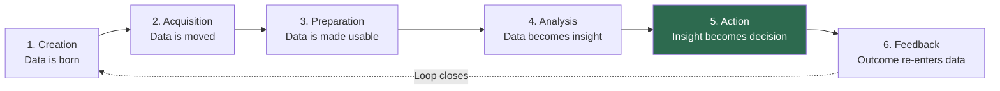
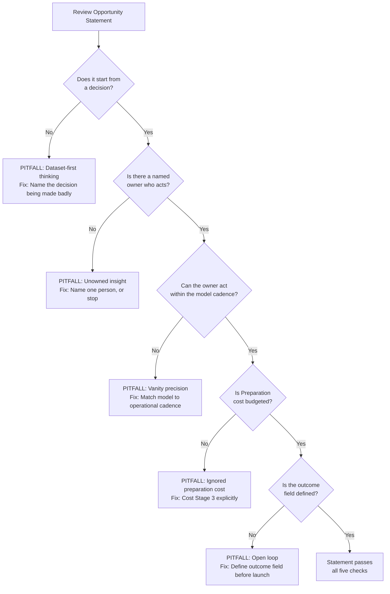

# Session 3: Data Lifecycle, Value Chain & Opportunity Diagnosis — Plain English

[Source: M2 S3]

---

## What You'll Learn

- Trace the six stages of the data lifecycle from creation to feedback, and explain what happens at each stage
- Tell the data lifecycle (process view) apart from the data value chain (management view)
- Find the six places where data value leaks, and work out which stage is weakest in a given initiative
- Apply the six-step opportunity diagnosis framework to turn a messy business problem into a precise big-data opportunity statement
- Write a complete opportunity statement naming a decision, an owner, a cadence, a threshold, and a risk
- Spot the five common pitfalls that cause opportunity statements to fail

---

## 1. The Six-Stage Data Lifecycle

[Source: M2 S3, slides 5-11]

### In short
The data lifecycle is a six-stage chain that tracks what physically happens to data from the moment it is created to the moment it drives a decision and the outcome feeds back into the system: Creation, Acquisition, Preparation, Analysis, Action, and Feedback.

### Why does it matter?
Most organisations treat data as a static asset — something you store and protect. The lifecycle reframes it as a journey with six handoffs, and each handoff can succeed or fail on its own. That matters because a failure anywhere breaks the whole chain. Data captured perfectly but never prepared is useless. Data analysed brilliantly but never acted on is an expense. The lifecycle gives managers a map for finding where an initiative actually breaks.

### How it works in practice
1. **Creation (Stage 1):** Data comes into existence — a card swipe at a point-of-sale terminal, a temperature reading from an IoT sensor (a physical sensor connected to the internet that reports readings), a customer filling in a web form, a support call being logged. The executive question here is instrumentation: which fields get captured, at what level of detail, and with what rights and consent?
2. **Acquisition (Stage 2):** Data moves from the system where it was born into a place where it can be used. Transfer mechanisms include batch extracts, APIs (the standard way one system pulls data from another), change-data-capture (CDC — copying only the records that changed since the last run), and continuous streams. The risk here is transfer lag: data arriving after the decision window has closed.
3. **Preparation (Stage 3):** Raw data becomes usable through cleaning, standardising formats and units, de-duplicating records, matching the same entity across systems, handling missing values, and agreeing business definitions. This stage consumes 60-80% of analytics team time, and it is the one most often under-funded, because it has no demo and no dashboard.
4. **Analysis (Stage 4):** Prepared data gets queried, aggregated, modelled, and visualised to answer a question — descriptive (what happened), diagnostic (why), predictive (what is likely next), or prescriptive (what should we do). This is the only stage anyone sees in a demo, and it depends completely on the quality of preparation.
5. **Action (Stage 5):** The insight gets built into a real decision or workflow — a retention offer that gets sent, a machine that gets serviced, a claim routed to investigation. This is the only stage that actually earns money. An insight that does not change a decision is an expense, not an asset.
6. **Feedback (Stage 6):** The outcome of the action is captured and fed back as new data, so the next cycle is measurably better than the last. Without feedback, year three of an initiative is no smarter than year one — only more expensive.

### Analogy
Think of the data lifecycle as a relay race with six runners. Runner 1 (Creation) picks up the baton when data is born. Runner 2 (Acquisition) carries it across the field to the analytics environment. Runner 3 (Preparation) runs the longest and hardest leg — uphill through mud, cleaning and reconciling everything. Runner 4 (Analysis) sprints through the modelling stage. Runner 5 (Action) crosses the finish line, where value is actually banked. Runner 6 (Feedback) carries the result back to the start so the next race is faster. Here is the catch: if Runner 3 drops the baton, Runners 4 and 5 never run — everything spent on the first two runners is wasted. And with no Runner 6, the team never learns whether it won or lost, so it runs the same race the same way forever.

### Real-world example
The session opens with a national retailer that ran a loyalty programme for six years. Every transaction was captured, stored, encrypted, and backed up — not one byte was lost, and the IT audit was spotless. When the CMO asked "Which customers are about to leave us?", it took eleven weeks to produce an answer. Loyalty IDs never matched app IDs, nobody owned the definition of "active customer", and by the time the list arrived, roughly a third of those customers had already gone. Creation and Acquisition were flawless. Preparation, Action, and Feedback never happened. The data was never lost — it just never finished the journey. [Source: M2 S3, slides 5-6]

### Pros and cons
| Pros | Cons |
|------|------|
| Gives you one diagnostic map for any data initiative | Doesn't prescribe which technology to use at each stage |
| Makes invisible failures visible, especially in Preparation and Feedback | Stages don't always separate cleanly in practice |
| Forces you to budget for the whole chain, not just storage | The framework is descriptive, not predictive — it tells you what broke, not why |
| Shows that value is banked only at Action, which stops "analysis for analysis' sake" | Needs honest self-assessment; organisations tend to overrate their own maturity |

### Why it matters for managers
The lifecycle is the most useful diagnostic tool a non-technical manager can bring to a data initiative review. Most failed data projects don't fail because of bad algorithms or slow hardware — they fail because the chain broke at a stage nobody was watching. The lifecycle teaches managers to ask "Which stage is weakest?" rather than "Do we have enough data?". A manager who can trace the six stages and find the break-point makes better investment decisions than one who approves projects on the promise of the analytical model alone.

### Exam-ready definition
> The data lifecycle is a six-stage chain — Creation, Acquisition, Preparation, Analysis, Action, and Feedback — describing the journey data must complete to create business value. Cost builds up at every stage, but value is realised only at Action, and Feedback closes the loop so the system can improve.

---

### Visual 1: The Six-Stage Data Lifecycle with Feedback Loop



**How to read it:** Six stages run left to right. Cost accumulates across them; value is realised only at Stage 5 (Action). The dashed arrow from Feedback back to Creation is the closed loop — outcomes become new data for the next cycle. [Source: M2 S3, slide 7]

**Exam tip:** Draw six boxes in a horizontal chain with a dashed return arrow from box 6 to box 1. Label each box with the stage name and a one-line description. Highlight box 5 to show where value is banked.

---

## 2. Data Value Chain vs. Data Lifecycle

[Source: M2 S3, slide 12]

### In short
The data value chain shows where economic value is added or destroyed along the same six-stage path as the data lifecycle. The lifecycle is the process view (what physically happens to data). The value chain is the management view (which stage carries the cost, which stage creates the margin, and which stage nobody owns).

### Why does it matter?
Managers who see only the lifecycle tend to treat all six stages as equally important. The value chain corrects that by showing cost running ahead of value for the first four stages — you spend money at Creation, Acquisition, Preparation, and Analysis without banking any return. Value is realised only at Action. This asymmetry explains why so many data projects feel expensive and unproductive: the organisation has invested heavily in stages 1-4 and has no mechanism to turn the output into a decision at Stage 5.

### How it works in practice
1. At **Creation**, costs are incurred (instrumentation, sensors, systems) but no value is generated yet.
2. At **Acquisition**, costs increase (transfer infrastructure, connectors, landing zones) but value stays at zero.
3. At **Preparation**, costs spike dramatically (this is the most expensive stage, consuming 60-80% of effort) while value is still zero.
4. At **Analysis**, costs continue (compute, tooling, data science salaries) and potential value becomes visible but is not yet captured.
5. At **Action**, value is finally realised — the insight changes a decision and produces measurable business impact.
6. At **Feedback**, the loop closes and the cost of future cycles falls as the system learns and improves.

### Analogy
Think of farming. You buy seeds (Creation cost), transport them to the field (Acquisition cost), spend months ploughing, watering, weeding, and fertilising (Preparation cost — by far the largest), and eventually the crop grows (Analysis — you can see the harvest potential). But you earn zero revenue until you actually sell the harvest at market (Action). If you never go to market, you have spent the whole season farming for nothing. And if you never test the soil after harvest (Feedback), next year you plant the same crop in depleted soil and wonder why the yield dropped. The value chain is the farmer's P&L laid over the growing calendar.

### Real-world example
In the retailer loyalty case from the session opener, the organisation invested heavily in Creation and Acquisition for six years — capturing every transaction, encrypting and backing up every byte. The IT audit showed perfect scores. But because Preparation was never funded (identities never reconciled, "active customer" never defined), the chain stalled at Stage 3. Six years of storage and infrastructure cost produced exactly zero business value, because no decision was ever improved. The value chain view makes this failure visible: the cost curve climbed for six years while the value curve stayed flat at zero. [Source: M2 S3, slide 12]

### Pros and cons
| Pros | Cons |
|------|------|
| Makes the cost-value asymmetry explicit and visible to executives | The exact cost and value at each stage is hard to put a number on |
| Stops "build it and they will come" thinking about data infrastructure | Can oversimplify — some value is indirect (e.g., regulatory compliance at Preparation) |
| Focuses investment discussions on closing the gap to Action | Ignores option value — data stored today may enable unforeseen future uses |
| Highlights the under-funding of Preparation as a systemic pattern | Needs a cultural shift; many organisations measure success by data volume, not decisions improved |

### Why it matters for managers
The value chain turns a technology conversation into a business conversation. When a CTO presents a data initiative, the manager trained in the value chain asks: "At which stage does value get banked, and who is the named owner of that stage?" If the answer is vague — "we will build the pipeline and then figure out the use cases" — the value chain predicts exactly what happens: costs accumulate, value doesn't, and the project gets quietly defunded in year two. The distinction between lifecycle and value chain is a reliable exam topic, because it tests whether you understand data as a management problem, not just a technology problem.

### Exam-ready definition
> The data value chain is the management view of the data lifecycle, mapping where economic value is added or destroyed at each of the six stages. It shows that cost accumulates from Creation through Analysis while value is realised only at Action, which makes Action and Feedback the most strategically critical stages.

---

### Visual 2: Cost and Value Across the Six Lifecycle Stages

| Stage | Cost Trend | Value Realised | Who Typically Owns It |
|-------|-----------|----------------|----------------------|
| 1. Creation | Low-moderate (instrumentation) | None yet | Source system owners, IT |
| 2. Acquisition | Moderate (transfer infra) | None yet | Data engineering |
| 3. Preparation | **Highest** (60-80% of effort) | None yet | Data engineering, business analysts |
| 4. Analysis | High (compute, data science) | Potential visible, not captured | Data science, analytics team |
| 5. Action | Low-moderate (workflow integration) | **Value realised** | Business decision-maker |
| 6. Feedback | Low (outcome capture) | Compounds future value | Often **nobody** — the most dangerous gap |

**How to read it:** The cost-value asymmetry across the lifecycle. Spend peaks at Preparation; value is banked only at Action. Check the "Who Typically Owns It" column — the stages that matter most for value (Action and Feedback) are the ones most often unowned. [Source: M2 S3, slide 12]

**Exam tip:** Draw a two-row table or a simple bar chart with cost on one axis and value on the other, showing cost climbing through stages 1-4 while value stays at zero, then value spiking at stage 5. This visual is a reliable 2-4 mark exam component.

---

## 3. The Six Places Where Data Value Leaks

[Source: M2 S3, slide 13]

### In short
Data value leaks are systematic failure modes — one per lifecycle stage — that silently destroy the potential business value of a data initiative. Each leak has its own signature: a capture gap at Creation, transfer lag at Acquisition, quality loss at Preparation, question drift at Analysis, no owner at Action, and an open loop at Feedback.

### Why does it matter?
Most data initiatives get reviewed on their analytical output — model accuracy, dashboard design, volume of data processed. The value-leak framework moves the review upstream and downstream, forcing managers to ask: "Even if the model is perfect, can the organisation actually act on it?" and "Even if we act, will we know whether it worked?" Those questions separate projects that generate value from projects that generate PowerPoint.

### How it works in practice
1. **Capture gap (Creation):** The field you need was never recorded, or only at the wrong level of detail. Example: a retailer captures transaction totals but not item-level basket data, which makes cross-sell analysis impossible. No downstream processing can recover data that was never captured.
2. **Transfer lag (Acquisition):** Data arrives days after the decision window has already closed. Example: a fraud-detection system gets transaction data in nightly batches, but the fraud window is 30 minutes. The data is complete and useless by the time it arrives.
3. **Quality loss (Preparation):** Duplicates, mismatched IDs, and disputed definitions corrupt every downstream figure. Example: the same customer appears as three different records because loyalty IDs were never reconciled with app IDs. Every model trained on this data inherits the defect.
4. **Question drift (Analysis):** The analysis answers an interesting question rather than the live decision the business actually needs. Example: a data science team builds an elegant customer-segmentation model, but the marketing team needs a churn score. The work is technically impressive and operationally irrelevant.
5. **No owner (Action):** Nobody is accountable for acting on the insight, so it gets circulated and forgotten. Example: a predictive maintenance score is published to a dashboard, but no maintenance planner has been assigned to review it or authorised to schedule downtime.
6. **Open loop (Feedback):** Outcomes are never captured, so the system cannot learn or prove its worth. Example: a retention offer goes to at-risk customers, but whether those customers actually stayed is never recorded. The model can't improve, and the business case can't be validated.

### Analogy
Imagine a hospital emergency department as a six-stage chain: the patient arrives (Creation), is triaged and moved to a bay (Acquisition), has vitals taken and history reviewed (Preparation), is diagnosed (Analysis), receives treatment (Action), and gets a follow-up appointment to check recovery (Feedback). A "capture gap" is a patient whose allergy history was never recorded — dangerous and irrecoverable. "Transfer lag" is a lab result that arrives after the patient has been discharged. "Quality loss" is two patient records that were never merged, so the doctor sees an incomplete history. "Question drift" is running a full genetic panel when the patient came in with a broken arm. "No owner" is a diagnosis written in a chart when no nurse is assigned to give the treatment. "Open loop" is sending the patient home with no follow-up, so the hospital never knows if the treatment worked. Each leak has a different fix, and diagnosing the right one is the whole skill.

### Real-world example
The faculty slide presents the six leaks as a diagnostic table, with the workshop instruction: "Before approving any data initiative, ask which of these six leaks the proposal actually closes." In the retail churn case, the primary leak was quality loss at Preparation (identity reconciliation failure), made worse by an open loop at Feedback (no mechanism to record whether the retention offer worked). Fixing model accuracy (Analysis) would have improved nothing, because the chain was already broken two stages earlier. [Source: M2 S3, slide 13]

### Pros and cons
| Pros | Cons |
|------|------|
| Gives managers a precise vocabulary for diagnosing data initiative failures | Leaks can co-occur, which makes root-cause identification harder |
| Shifts review from "Is the model good?" to "Can the organisation use the model?" | Needs cross-functional visibility that many organisations lack |
| Prevents spending on downstream fixes for upstream problems | Some leaks (especially capture gaps) are expensive or impossible to fix retroactively |
| Works as a pre-approval checklist — ask which leak the proposal closes | Doesn't put a cost on each leak; prioritising still needs judgement |

### Why it matters for managers
The six-leak diagnostic is arguably the most practical tool in this session for a working manager. Most organisations instinctively invest in Analysis (better models, more data scientists, fancier dashboards) when the real failure is at Preparation (data quality), Action (no decision owner), or Feedback (no outcome capture). A manager who correctly diagnoses the leak stage redirects investment to where it matters — and stops approving projects that promise analytical brilliance but have no mechanism to turn it into a decision.

### Exam-ready definition
> Data value leaks are six stage-specific failure modes — capture gap, transfer lag, quality loss, question drift, no owner, and open loop — that silently destroy the potential value of a data initiative. Diagnosing the correct leak tells you where investment should go.

---

### Visual 3: The Six Value Leaks Diagnostic Table

| Stage | Leak Type | What It Looks Like | The Fix |
|-------|-----------|--------------------|---------|
| Creation | Capture gap | The field you need was never recorded | Instrument the source system; cannot be fixed downstream |
| Acquisition | Transfer lag | Data arrives after the decision window closes | Match transfer frequency to decision cadence |
| Preparation | Quality loss | Duplicates, mismatched IDs, disputed definitions | Fund identity resolution and definition governance |
| Analysis | Question drift | Analysis answers an interesting question, not the live decision | Start from the decision, work backward to the analysis |
| Action | No owner | Insight is circulated but nobody is accountable for acting | Name one person who will act, or stop the project |
| Feedback | Open loop | Outcomes are never captured; system cannot learn | Define the outcome field before launch |

**How to read it:** The six value leaks mapped to lifecycle stages. Each leak has its own signature and its own fix. Workshop habit from the faculty material: before approving any data initiative, ask which of these six leaks the proposal actually closes. [Source: M2 S3, slide 13]

**Exam tip:** Memorise the six leak names (capture gap, transfer lag, quality loss, question drift, no owner, open loop), the stage each belongs to, and a one-line description. A 5-mark question could ask you to list all six; a 10-mark question could ask you to diagnose which leak applies in a given case.

---

## 4. Opportunity Diagnosis Framework

[Source: M2 S3, slides 14-15]

### In short
Opportunity diagnosis is a six-step process for turning a messy business problem into a precise big-data opportunity statement — a single paragraph naming the decision, the decision-maker, the data sources, the analytical output, the action, the estimated value, and the assumptions and risks.

### Why does it matter?
Most data initiatives start with a dataset ("we have five years of clickstream" — the log of clicks and page views on a website or app) rather than a decision ("which customers get a retention offer each week"). Dataset-first thinking produces technically interesting work that nobody uses. The opportunity diagnosis framework forces the conversation to start from the decision and work backward to the data, so that every part of the initiative — from ingestion to model to dashboard — is justified by a specific operational action.

### How it works in practice
1. **Name the decision, not the dataset.** "Which customers get a retention offer?" — not "we have loyalty data". If you cannot name a live decision that is currently being made badly, there is no opportunity.
2. **Identify the decision-maker and cadence.** Who signs it off, and how often must they decide — weekly, daily, on-event? This sets the pipeline refresh rate and the latency requirement.
3. **Trace backward to the data required.** From the decision, work back to the minimum fields that would change it. Don't start from all the data you have; start from the decision and pull only what you need.
4. **Test availability against the lifecycle.** For each required field: is it created? is it acquirable? is it preparable — and at what cost? This step surfaces capture gaps and preparation costs before the project is approved.
5. **Estimate the value of a better decision.** What is a 5% improvement in this decision worth per cycle? This forces a quantitative business case instead of a vague promise of "better insights".
6. **Write the opportunity statement.** Commit it to one paragraph with explicit assumptions and risks. If any element can't be filled in specifically, that is your next piece of work — not a detail to settle later.

### Analogy
Think of a doctor diagnosing a patient. A bad doctor starts from the test results ("your cholesterol is high — let us run more tests"). A good doctor starts from the symptom and works backward: "What is the complaint? What decision must I make? What is the minimum test that would change my treatment plan? What is the cost of the test versus the cost of getting the treatment wrong?" The opportunity diagnosis framework is the clinical method applied to data: start from the decision (the treatment), not the data (the lab results). Here is the follow-through: just as a doctor who orders every possible test is wasteful and slow, a data team that ingests every available dataset without a decision to serve is burning budget without improving outcomes.

### Real-world example
The faculty provides a template and a completed example. The template structure is:

**For** [the decision-maker] **who must decide** [the decision and cadence], **we will combine** [the data sources] **to produce** [the analytical output], **enabling** [the action], **worth approximately** [the value], **provided** [the assumptions and risks].

The completed example reads: "For the Regional Retention Head, who must decide which customers receive a retention offer each week, we will combine six years of POS (point-of-sale) transactions, the loyalty master, and app clickstream to produce a weekly churn-risk score with the top three drivers per segment, enabling a targeted offer to the highest-risk 5% of active customers, worth approximately the retained margin on 1 in 5 of those customers, provided loyalty and app identities can be reconciled, and the campaign team can act within 72 hours of the score being published."

The faculty notes four reasons this statement survives scrutiny: a real owner (a named role with authority), a real cadence (weekly — so the pipeline refresh rate is defined), a real threshold (top 5% — so the model output has an operational cut-off), and a real risk (identity reconciliation is called out, not hidden). [Source: M2 S3, slides 15-16]

### Pros and cons
| Pros | Cons |
|------|------|
| Forces decision-first thinking and kills dataset-first projects | Needs a decision-maker who exists and can be identified |
| Makes assumptions and risks explicit before investment | The value estimate is inherently uncertain and can be gamed |
| Defines pipeline requirements (cadence, freshness, sources) naturally | Doesn't address technical feasibility — only business justification |
| Creates a one-paragraph artefact that executives can review and challenge | Organisations with weak data governance may not be able to fill in the template |

### Why it matters for managers
The opportunity statement is the deliverable a manager should demand before approving any data initiative. It is not a business case document or a technical architecture — it is one paragraph that forces clarity on seven dimensions: who decides, what they decide, how often, what data is needed, what the output looks like, what action changes, and what must be true for this to work. If the team cannot fill in every bracket, the project is not ready for funding — it is ready for more diagnosis. Steps 1 and 2 (naming the decision and its owner) are where most proposals fail, because most proposals begin with data availability rather than decision need.

### Exam-ready definition
> Opportunity diagnosis is a six-step process that converts a business problem into a structured opportunity statement by starting from the decision (not the dataset), identifying the decision-maker and cadence, tracing backward to the minimum required data, testing availability against the lifecycle, estimating the value of improvement, and committing assumptions and risks to a single reviewable paragraph.

---

### Visual 4: Anatomy of a Big-Data Opportunity Statement

```
+------------------------------------------------------------------+
|  FOR        [ the decision-maker ]        A named role who acts   |
|  WHO MUST   [ decision + cadence ]        The recurring choice    |
|  DECIDE                                                          |
|  WE WILL    [ data sources ]              Named systems, not     |
|  COMBINE                                  "our data"             |
|  TO         [ analytical output ]         Score, ranking,        |
|  PRODUCE                                  forecast, or flag      |
|  ENABLING   [ the action ]                What changes           |
|                                           operationally          |
|  WORTH      [ the value ]                 Quantified per cycle   |
|  APPROX.                                  or per year            |
|  PROVIDED   [ assumptions & risks ]       What must be true      |
+------------------------------------------------------------------+
   If any bracket cannot be filled in specifically,
   that is your next piece of work -- not a detail to settle later.
```

**How to read it:** The seven-bracket anatomy of a big-data opportunity statement. Each bracket maps to one element that has to be concrete and specific. An empty bracket is not something to fill in later — it tells you what work remains before the project is fundable. [Source: M2 S3, slide 15]

**Exam tip:** Reproduce this as a simple vertical list of the seven elements (For / Who must decide / We will combine / To produce / Enabling / Worth approximately / Provided), each with a one-line description. Use it for any question asking you to write or critique an opportunity statement.

---

## 5. Business Problem #1: Retail Churn — Walking the Full Lifecycle

[Source: M2 S3, slides 16-17]

### In short
Business Problem #1 is a worked example that traces a retail customer-churn prediction initiative through all six lifecycle stages, showing how each stage adds to (or undermines) the final business outcome.

### Why does it matter?
Abstract frameworks only become useful when you see them applied end to end. The retail churn case is chosen deliberately, because it touches every stage and every common failure mode: multiple data sources with different refresh rates, identity reconciliation problems, a model that depends on preparation quality, an action that needs operational coordination, and a feedback loop that decides whether the initiative improves over time.

### How it works in practice
1. **Creation:** POS (point-of-sale) transactions, loyalty sign-ups, and app events across 600 stores and two digital channels. Executive watch-point: app events lack a loyalty ID for guest checkouts — a capture gap.
2. **Acquisition:** Nightly batch extract from POS; streaming event feed from the app; weekly CRM (customer relationship management) dump. Watch-point: three different refresh rates land in the same table, creating freshness mismatches.
3. **Preparation:** Reconcile identities, standardise SKUs (product codes), define "active customer" as a 90-day purchaser. Watch-point: this is the largest effort, and the stage that decides whether everything below it can be trusted.
4. **Analysis:** A Spark pipeline (Spark is the distributed processing engine for very large datasets) aggregates behaviour; clustering builds micro-segments; a churn score is computed per customer. Watch-point: the score is only as good as the identity resolution above it.
5. **Action:** The top 5% at-risk customers are routed to the weekly retention campaign. Watch-point: the campaign team has to act inside the 72-hour window between score publication and offer expiry.
6. **Feedback:** Offer acceptance and 90-day retention are captured and fed back into the next model run. Watch-point: without this, year three performs no better than year one.

### Analogy
Imagine a restaurant chain trying to predict which regular diners are about to stop coming. Stage 1: the reservation system, the POS, and the loyalty app each record visits differently. Stage 2: reservation data updates in real time, the POS syncs nightly, and the loyalty app dumps weekly — three clocks, one question. Stage 3: the chef knows "Chef Giovanni" and "G. Rossi" are the same person, but the database does not. Stage 4: the analytics team builds a beautiful churn model, but it thinks Giovanni is three people and scores each fragment differently. Stage 5: the host is supposed to offer a complimentary dessert to at-risk diners, but the list arrives on Thursday and Giovanni dines on Tuesday. Stage 6: nobody records whether Giovanni came back after the dessert. The walk-through shows the restaurant realising that the dessert offer (Action) will fail unless the identity problem (Preparation) and the timing mismatch (Acquisition) are fixed first. [Supplementary illustration]

### Real-world example
The faculty slide specifies: industry is Retail; tools are PySpark, SQL (the standard language for querying databases) and Power BI (business intelligence — the dashboards and reporting tool); theory linked is data lifecycle and value chain, volume and variety. The discussion prompt asks: "Which single stage, if fixed first, would unlock the most value here — and what would it cost?" The intended answer is Preparation (identity reconciliation), because every downstream stage — the churn score, the campaign routing, and the feedback loop — depends on knowing that a loyalty swipe, an app session, and a web visit belong to the same person. [Source: M2 S3, slide 17]

### Pros and cons
| Pros | Cons |
|------|------|
| Demonstrates every lifecycle stage in one coherent case | Retail-specific; students must generalise to other industries |
| Shows that the weakest stage (Preparation) sets the ceiling for every stage below it | Doesn't put a cost on fixing each stage |
| Highlights operational dependencies (72-hour action window, campaign team coordination) | Squashes a multi-year programme into a single-page table |
| Gives you a model for presenting a lifecycle walk-through in an exam answer | "Which stage to fix first" has no single right answer without cost data |

### Why it matters for managers
The retail churn case is the session's anchor example and the most likely source of an exam case question. A manager reviewing this initiative should ask three questions, in order: (1) Is the identity reconciliation funded? (2) Can the campaign team act within the score's freshness window? (3) Is there a mechanism to capture outcomes and feed them back? If any answer is no, the analytical model — however accurate — will not generate value. The case teaches that operational readiness (Action) and learning capability (Feedback) matter as much as analytical sophistication (Analysis).

### Exam-ready definition
> Business Problem #1 (Retail Churn) is a worked example tracing a customer-churn prediction initiative through all six lifecycle stages. It shows that the weakest stage — typically Preparation (identity reconciliation) — sets the value ceiling for the entire initiative, whatever the model accuracy.

---

## 6. Common Pitfalls in Opportunity Statements

[Source: M2 S3, slide 18]

### In short
The five common pitfalls are recurring failure patterns in big-data opportunity statements: dataset-first thinking, the unowned insight, vanity precision, ignored preparation cost, and the open loop.

### Why does it matter?
Even teams that understand the lifecycle and the opportunity framework still fall into predictable traps. The five pitfalls work as a final checklist — a last-pass quality gate before an opportunity statement goes in for funding. Each pitfall has a characteristic phrase that reveals it and a specific correction.

### How it works in practice
1. **Dataset-first thinking.** Sounds like: "We have five years of clickstream — what can we do with it?" The correction: start from a decision that is already being made badly, not from available data.
2. **The unowned insight.** Sounds like: the output goes to a distribution list rather than a named role. The correction: name one person who will act, or stop the project.
3. **Vanity precision.** Sounds like: "a churn model at 94% accuracy" — but nobody can act on it within the week. The correction: match model cadence to operational cadence. A 70%-accurate model acted on in 24 hours beats a 94%-accurate model acted on in 11 weeks.
4. **Ignored preparation cost.** Sounds like: the budget covers the model but nothing covers identity reconciliation, data cleaning, or definition governance. The correction: cost Stage 3 (Preparation) explicitly before approving the project.
5. **The open loop.** Sounds like: there is no mechanism to record whether the action worked. The correction: define the outcome field before launch, not after the first review meeting.

### Analogy
Think of the five pitfalls as five ways to fail at cooking dinner for guests. Dataset-first thinking is opening the fridge and saying "I have eggs and cheese — what can I make?" instead of asking what the guests want to eat. The unowned insight is cooking a beautiful meal but putting it on the counter with no plates or cutlery and hoping someone serves themselves. Vanity precision is spending four hours perfecting a souffle when the guests arrive in thirty minutes — a good omelette served on time is worth more. Ignored preparation cost is budgeting for the steak but forgetting to buy salt, oil, and a pan. The open loop is never asking the guests whether they enjoyed the meal, so next time you make the same mistakes. [Supplementary illustration]

### Real-world example
The faculty slide presents each pitfall with a "what it sounds like" phrase and a correction. In the retail churn context: the original initiative was dataset-first ("we have six years of loyalty data"), the insight was initially unowned (the churn list went to a distribution list, not the Regional Retention Head), preparation cost was ignored (identity reconciliation was not budgeted), and the loop was open (offer acceptance was not captured). The corrected opportunity statement in slides 15-16 explicitly addresses each pitfall. [Source: M2 S3, slide 18]

### Pros and cons
| Pros | Cons |
|------|------|
| Gives you a concrete checklist for reviewing any opportunity statement | Five pitfalls are not exhaustive — other failure modes exist (e.g., regulatory blockers) |
| Each pitfall has a diagnostic phrase that makes it easy to spot | Organisations may show several pitfalls at once |
| Corrections are specific and actionable, not generic advice | Fixing a pitfall (e.g., naming an owner) needs organisational authority, not just analytical skill |
| Maps directly to the lifecycle stages and value chain concepts taught earlier | The checklist becomes bureaucratic if applied mechanically without judgement |

### Why it matters for managers
The five pitfalls are the quality gate for any data initiative proposal. A manager who memorises these five failure patterns and their diagnostic phrases can review a proposal in five minutes and say whether it is ready for funding or needs more work. The most dangerous pitfall is the open loop, because it is the one most often deferred ("we will figure out measurement later") and the one that permanently stops the initiative from proving its value or improving over time.

### Exam-ready definition
> The five common pitfalls in big-data opportunity statements are dataset-first thinking, the unowned insight, vanity precision, ignored preparation cost, and the open loop. Each has a diagnostic phrase and a specific correction, and together they work as a pre-approval checklist for any data initiative.

---

### Visual 5: Five Pitfalls Diagnostic Checklist



**How to read it:** A decision-tree checklist for the five common pitfalls. Run any opportunity statement through these five gates before you approve it. A failure at any gate names the specific pitfall and its correction. [Source: M2 S3, slide 18]

**Exam tip:** Draw it as a simple five-question flowchart, with each "No" branch naming the pitfall and the fix. A 10-mark essay could ask you to apply this checklist to a case study and say which pitfalls are present.

---

## Key Takeaways

[Source: M2 S3, slide 19]

- **Data creates value only by completing all six lifecycle stages** — storage alone is not a lifecycle. A project that stops at Analysis has spent everything and earned nothing.
- **Preparation consumes the most effort and is the most under-funded stage.** It has no demo and no dashboard, so it rarely gets a budget line — yet it sets the ceiling for every stage downstream.
- **The lifecycle is the process view; the value chain is the management view** of the same six-stage path. Cost runs ahead of value for stages 1-4; value is banked only at Stage 5 (Action).
- **Value is banked only at Action.** An insight that does not change a decision is an expense, not an asset. A named decision-owner, an agreed cadence, and a defined threshold are non-negotiable.
- **A real opportunity statement names a decision, an owner, a cadence, a threshold, and a risk.** If any bracket in the template can't be filled in specifically, that is the next piece of work — not a detail to settle later.
- **Five pitfalls kill opportunity statements:** dataset-first thinking, the unowned insight, vanity precision, ignored preparation cost, and the open loop. Each has a diagnostic phrase and a specific correction.

**Bridge to Session 4:** You can now state what decision the data must serve, and diagnose where the lifecycle breaks. Session 4 asks the next question: what has to be built — what are the architectural layers — for the data to actually get from source to decision?
