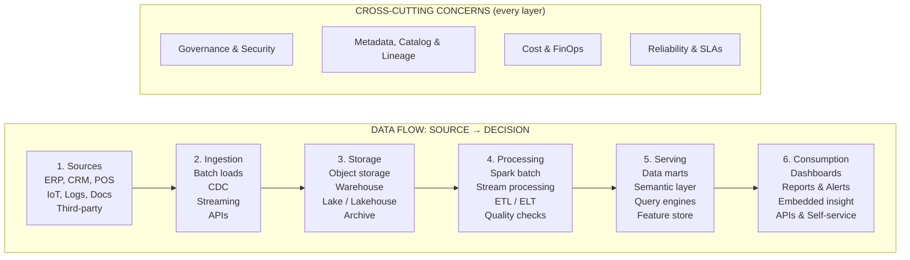
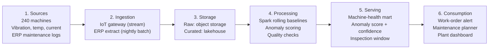

# Session 4: Reference Architecture — Source to Decision — Plain English

[Source: M2 S4]

---

## What You'll Learn

[Source: M2 S4, slides 20-22]

- Name the six standard layers of a big-data reference architecture and say what each one does
- Separate the cross-cutting concerns (governance, metadata, cost, reliability) that run through every layer
- Compare the batch path and the streaming path, and pick the right one for each decision
- Read the dependencies between layers and explain why a defect upstream can never be fixed downstream
- Apply the seven-question framework to any architecture diagram
- Map one business problem (IoT predictive maintenance) onto all six layers, from source to decision

---

## 1. The Six-Layer Reference Architecture

[Source: M2 S4, slide 22]

### In short
A reference architecture is a standard blueprint that works for any big-data platform, whichever vendor's logo sits on it. It splits the platform into six layers — Sources, Ingestion, Storage, Processing, Serving, and Consumption — where a layer is one stage of the path data travels. Four cross-cutting concerns (Governance and Security, Metadata and Lineage, Cost and FinOps, Reliability and SLAs) run through every layer.

### Why does it matter?
Every vendor draws its diagram differently. AWS, Azure, GCP, Databricks, Snowflake and a hundred startups each lay out boxes and arrows to show off their own products. Without a shared frame, an executive who sees five vendor pitches in a week has nothing to compare them with. Learn the six layers once and you can read any architecture diagram put in front of you, whatever the product names say.

### How it works in practice
1. **Layer 1 — Sources:** where data starts — ERP, CRM, POS, IoT (internet of things: connected sensors and devices) sensors, application logs, documents, third-party feeds.
2. **Layer 2 — Ingestion:** how data gets into the platform — batch processing (loading a whole chunk of data on a fixed schedule), CDC (change-data-capture: copying only the records that changed), event streaming (Kafka-style, where Kafka is the open-source event streaming platform), API connectors (a standard way for one system to pull data from another), file drops.
3. **Layer 3 — Storage:** where data sits — object storage, data warehouse (structured, fixed-schema storage built for reporting), data lake (raw files kept in whatever format they arrived), lakehouse tables (lake storage with warehouse-style governance), archive and cold tiers.
4. **Layer 4 — Processing:** how data is reshaped — distributed batch processing (Spark, an engine that handles huge datasets across many machines), stream processing (handling records one at a time as they arrive), ETL/ELT jobs (Extract-Transform-Load / Extract-Load-Transform workflows that move data between layers), data-quality checks, orchestration.
5. **Layer 5 — Serving and Analytics:** how data becomes queryable — curated data marts, semantic/metric layer, query engines, feature stores (a versioned store of the input variables an ML model uses), model scoring services.
6. **Layer 6 — Consumption:** how people act on it — dashboards, scheduled reports, alerts, insight embedded in apps, APIs that push results into operational systems, self-service exploration.

Four cross-cutting concerns run through every layer:
- **Governance and Security:** access control, data classification, privacy, audit trails.
- **Metadata, Catalog, and Lineage:** a metadata catalogue (a list of what data exists, where it came from, and how it was changed) plus lineage.
- **Cost and FinOps:** storage, compute, egress, licensing, migration, skills, and exit costs.
- **Reliability and SLAs:** uptime, recovery, freshness guarantees, and incident response.

### Analogy
Think of an airport baggage system. You hand over a suitcase at the check-in desk (Sources). It is tagged and scanned (Ingestion), held in a sorting hall (Storage), routed by a machine that reads the tag (Processing), sent down the right chute (Serving), then placed on a carousel where you collect it (Consumption). Six systems, six handoffs, one promise — not "we will store your bag well", but "your bag will be at the other end when you arrive". Every layer exists to keep that promise, and a failure at any one of them looks the same to you: an empty carousel. The cross-cutting concerns are the security cameras, the tracking systems, the cost controls and the uptime guarantees running through every room of the airport — not a seventh room at the end.

### Real-world example
Consider a manufacturing company running IoT predictive maintenance (Business Problem #5). The six layers map directly: 240 machines with vibration, temperature and current sensors (Sources); a cloud IoT gateway streaming events continuously plus nightly ERP batch loads (Ingestion); raw sensor events in object storage and curated machine-health tables in a lakehouse (Storage); Spark jobs computing rolling baselines and anomaly scores, where anomaly detection means spotting data that doesn't behave normally (Processing); a machine-health mart exposing scores, confidence bands and recommended inspection windows (Serving); work-order alerts that route to the maintenance planner (Consumption). Drop any single layer and the promise breaks: sensors without ingestion are unread, ingestion without processing is raw noise, processing without serving is a score nobody can query, serving without consumption is a number nobody acts on. [Source: M2 S4, slides 22 and 32]

### Pros and cons
| Pros | Cons |
|------|------|
| Vendor-neutral — works for any platform or cloud provider | Abstract — names no products or configurations |
| Gives executives a common frame to compare proposals | Layers interact in practice; the boundaries are not always clean |
| Cross-cutting concerns stop governance being bolted on afterwards | Cross-cutting concerns are easy to list and hard to build |
| Learn it once, read any architecture diagram | Does not tell you how to choose between options inside a layer |

### Why it matters for managers
This is the most important structural idea in the module. It gives you the vocabulary to ask the right questions in any architecture conversation — with a vendor, a consultant, or your own team. The key insight is that governance, metadata, cost and reliability run through every layer. They are not a seventh layer tacked on at the end. A proposal that treats security as a final step or cost as an afterthought is structurally defective, however impressive its processing engine looks.

### Exam-ready definition
> A reference architecture organises any big-data platform into six standard layers — Sources, Ingestion, Storage, Processing, Serving and Consumption — with Governance, Metadata, Cost and Reliability as cross-cutting concerns running through every layer, giving a vendor-neutral blueprint that lets an executive read and compare any architecture diagram.

---

### Visual 1: The Six-Layer Reference Architecture

The six layers in one row, with the four cross-cutting concerns sitting underneath and applying to all of them. Every vendor's diagram resolves to these six layers, whatever the product names. [Source: M2 S4, slide 22]

**Exam tip:** Draw six boxes in a row labelled 1-Sources through 6-Consumption, joined by arrows. Under the row, draw a horizontal bar labelled "Cross-cutting: Governance, Metadata, Cost, Reliability". Name at least two components per layer.

---

## 2. Layer 1 — Sources

[Source: M2 S4, slide 23]

### In short
The Sources layer holds the systems where data is already created as a by-product of running the business — transactional systems (ERP, CRM, POS), IoT and sensor feeds, application and server logs, documents and correspondence, and purchased or public third-party data. Each source comes with its own owner, refresh rate, format and usage rights.

### Why does it matter?
You rarely build source systems for analytics — you inherit them. They exist because the business runs on them: the ERP processes orders, the CRM tracks customer relationships, the POS records sales, the sensors monitor equipment. The analytics architecture taps into these systems to extract the data they produce. This layer matters because it sets the ceiling for everything downstream: you can only ever analyse what somebody, at some point, decided to record.

### How it works in practice
1. **Identify source systems:** catalogue every system that generates data relevant to the decision — ERP, CRM, POS, IoT sensors, application logs, documents, third-party feeds.
2. **Determine ownership:** each source has a business-unit owner who controls the system, the schema (the agreed structure of the data) and the refresh rate.
3. **Assess instrumentation:** what fields are captured, at what granularity, and how consistently? A field that was never mandatory, or a channel that was never instrumented, creates a silent gap.
4. **Confirm rights and consent:** does the organisation have the legal right to use this data for the intended analytical purpose? Consent, licensing and contractual terms must be checked before extraction begins.
5. **Document format and refresh:** each source has its own format (structured tables, JSON, CSV, binary) and its own refresh rate (real-time events, daily batches, weekly dumps).

### Analogy
The Sources layer is like the farms that supply a restaurant. The chef (the analytics team) does not grow the ingredients — the farms already exist for their own reasons. The chef's job is to know which farms supply which ingredients, how fresh the delivery is, whether the farm is certified (rights), and what happens when a farm has a bad harvest (a capture gap). A chef who doesn't know the supply chain will eventually serve a dish with missing or spoiled ingredients. An analytics team that doesn't know the source systems will eventually deliver an analysis built on missing or stale data.

### Real-world example
In the predictive maintenance case (Business Problem #5), the Sources layer is vibration, temperature and current sensors on 240 machines, sampled every second, plus maintenance logs stored in the ERP. The executive watch-point: are all 240 machines instrumented, or do some older ones lack sensors? If 40 machines have no vibration sensor, the model will never predict their failures — and that gap is invisible to anyone looking only at the dashboard. [Source: M2 S4, slides 23 and 32]

### Pros and cons
| Pros | Cons |
|------|------|
| Source systems already exist — no need to build from scratch | You inherit their limits: missing fields, wrong granularity, legacy formats |
| Rich, authoritative record of actual business events | Source ownership is often unclear or split across business units |
| IoT and digital channels generate high-volume, high-frequency data | Rights and consent must be checked per source and per use case |
| Third-party data can fill gaps in internal sources | Third-party feeds change with the vendor, their pricing and their availability |

### Why it matters for managers
The executive question for the Sources layer is: "Do we have the rights to use this source, and is it instrumented for the decision we actually want to make?" If either answer is no, nothing downstream can compensate. Silent capture gaps — a field that was never mandatory, a channel that was never instrumented, a legacy system that only exports weekly totals — are the most common cause of analytics project failure. They surface mid-project, months after budgets were approved, when the source can no longer be fixed.

### Exam-ready definition
> The Sources layer holds the original, authoritative record of business events across transactional systems, IoT feeds, logs, documents and third-party data — each with its own owner, format, refresh rate and usage rights — and sets a permanent ceiling for all downstream analytics, because data that was never captured cannot be recovered.

---

## 3. Layer 2 — Ingestion

[Source: M2 S4, slide 24]

### In short
The Ingestion layer is the transport that moves data out of source systems and into the analytics platform — on a schedule or continuously — without slowing down the operational systems that run the business.

### Why does it matter?
Source systems are built to run the business, not to serve analytics. Extracting data from them has to be done carefully: too aggressively and the production system slows down; too infrequently and the analysis is stale. This layer solves that by providing a controlled, monitored transport path that matches the freshness each decision needs — batch for daily reporting, streaming for real-time (seconds to minutes) alerts — while handling retries, back-pressure (slowing the source down when the pipeline can't keep up) and failure alerting.

### How it works in practice
1. **Batch / scheduled loads:** extract data on a fixed schedule (hourly, nightly, weekly) and load it in bulk. Fits decisions that run on a reporting calendar.
2. **Change-data-capture (CDC):** mirror database updates incrementally by reading the transaction log. Near-real-time freshness without re-extracting everything.
3. **Event streaming (Kafka-style):** a continuous flow of individual events from source to platform. Fits decisions that expire in seconds or minutes.
4. **API connectors:** pull data from external services (SaaS platforms, partner APIs, public datasets) on demand or on schedule.
5. **File drops / SFTP:** legacy or partner data delivered as files to a landing zone. Still common in regulated industries.
6. **Monitoring and alerting:** the layer must detect and alert on feed failures — because a feed that stops silently is the most dangerous failure mode.

### Analogy
The Ingestion layer is the conveyor belt in a factory. Raw materials arrive at different speeds — some by the truckload once a day (batch), some piece by piece on a continuous belt (streaming). The conveyor system must handle both without jamming the factory floor. If the conveyor stops, the factory does not necessarily stop, but the next shift's work gets built on yesterday's materials and nobody on the floor notices until the finished product is wrong. A silent conveyor failure is worse than a loud breakdown: a loud breakdown gets fixed at once, a silent one corrupts output for days.

### Real-world example
In the predictive maintenance case, ingestion runs two paths at once: a cloud IoT gateway streams sensor events continuously (vibration readings every second from 240 machines), while ERP maintenance history loads nightly in batch. The executive watch-point: the streaming feed gives real-time freshness, but if the nightly ERP batch fails silently, the anomaly model loses its historical context. The dashboard still renders, the scores still appear — they are simply wrong, because the model is scoring against stale baselines. Analytics that look complete but are silently stale is the most dangerous form of ingestion failure. [Source: M2 S4, slides 24 and 32]

### Pros and cons
| Pros | Cons |
|------|------|
| Decouples analytics from production — extraction doesn't slow the business | Several ingestion patterns (batch, CDC, streaming) add operational complexity |
| Freshness can be matched to each decision's cadence | Silent failures make stale data look complete |
| CDC and streaming enable near-real-time analytics without full re-extraction | Streaming infrastructure is always-on and more expensive to run |
| Monitoring and alerting catch feed failures before they corrupt downstream output | Monitoring must be built and maintained — it is not automatic |

### Why it matters for managers
The executive question for the Ingestion layer is: "How fresh must this data be to change the decision — and who gets paged when a feed stops?" The first half prevents over-investment in streaming when batch would do. The second half prevents the most dangerous failure: a feed that stops silently, producing dashboards that look normal while the numbers are yesterday's, or missing one region entirely. If no one is paged, no one responds.

### Exam-ready definition
> The Ingestion layer transports data from source systems into the analytics platform using batch, CDC, streaming or API patterns matched to each decision's freshness requirement — and its most dangerous failure mode is a silent feed stoppage that makes stale or partial data look complete.

---

## 4. Layer 3 — Storage

[Source: M2 S4, slide 25]

### In short
The Storage layer is where data rests between arriving and being used — held at the volume, durability and access speed the workload needs. It is the cheapest layer to fill and the most expensive to clean up later.

### Why does it matter?
Data must be held somewhere between ingestion and processing, and between processing and serving. The Storage layer provides that holding area with proper durability (data is not lost), access control (only authorised users can read it) and cost efficiency (hot data on fast storage, cold data on cheap storage). Storage design also sets retention periods and how easily data can be deleted on request — both critical for compliance.

### How it works in practice
1. **Object storage:** low-cost, highly durable storage for raw files in any format. The default landing zone for data lakes. Columnar file formats such as ORC and Parquet are common because they store data column by column, which makes queries faster.
2. **Data warehouse:** structured, schema-on-write storage — the structure is fixed before the data lands, the way a traditional RDBMS (relational database management system) works — tuned for SQL queries (the standard language for querying databases) and reporting. Highest cost per terabyte, highest query performance.
3. **Data lake:** a large pool of raw data in object storage or in a classic distributed file system such as HDFS (Hadoop Distributed File System), kept in whatever format it arrived. Schema-on-read: the structure is applied when someone queries it. Cheap to fill, expensive to trust. Without good metadata and governance, a lake turns into a data swamp — cheap to fill, impossible to search or trust.
4. **Lakehouse tables:** a transactional table layer on top of lake storage, combining the economics of a lake with the governance of a warehouse (Delta Lake, Iceberg).
5. **Archive / cold tiers:** very low-cost storage for data that must be kept but is rarely opened. Retrieval takes minutes to hours.
6. **Retention policies:** rules on how long data is kept, when it moves to cold storage and when it is deleted. Without them, storage grows quietly forever.

### Analogy
The Storage layer is like a warehouse building. The ground floor (hot storage) is expensive per square metre but you can retrieve anything in seconds — put the items you need every day here. The basement (warm storage) is cheaper but takes a few minutes to reach. The off-site facility (cold/archive) costs almost nothing per square metre but retrieving an item takes hours. Without a retention policy you keep everything forever, the warehouse fills up, and you pay rent on boxes nobody has opened in five years. That rent is the cloud storage bill — small per unit, enormous in total, and it arrives every month whether anyone uses the data or not.

### Real-world example
In the predictive maintenance case, storage is split by purpose: raw sensor events (terabytes per day of vibration, temperature and current readings) land in low-cost object storage because they must be kept for model retraining and regulatory audit but are rarely queried directly. Curated machine-health tables — cleaned, aggregated and scored — sit in a lakehouse that provides ACID guarantees (all-or-nothing, consistent transactions) and versioning. This two-tier approach keeps raw data cheap while the tables the model and the dashboard actually use stay governed, versioned and queryable. [Source: M2 S4, slides 25 and 32]

### Pros and cons
| Pros | Cons |
|------|------|
| Object storage is extremely cheap and highly durable | Cheap storage encourages hoarding — cost drift is silent |
| Tiered storage (hot/warm/cold) matches cost to access pattern | Retention policies must be designed and enforced, not assumed |
| Lakehouse tables add governance to lake economics | Lakehouse adds complexity and needs new skills |
| Retention policies control cost and compliance exposure | Deleting on request (GDPR, DPDPA) is hard to implement retroactively |

### Why it matters for managers
The executive question for the Storage layer is: "Who can read what, how long do we keep it, and what does it cost us every month to hold?" This is where cost drift and compliance exposure grow invisibly. The monthly bill is small per gigabyte, but terabytes pile up over years. Without retention policies and access controls, storage grows quietly until an audit, a data-subject deletion request or an invoice makes it visible — and by then the cleanup is expensive.

### Exam-ready definition
> The Storage layer persists data at the volume, durability and access speed the workload requires — from low-cost object storage for raw files, through structured warehouses, to lakehouse tables — and is the cheapest layer to fill and the most expensive to clean up later, needing retention policies and access controls to prevent silent cost drift and compliance exposure.

---

## 5. Layer 4 — Processing

[Source: M2 S4, slide 26]

### In short
The Processing layer is where raw data is turned into something a business can trust — cleaned, joined, standardised and aggregated according to rules that have been explicitly agreed and documented.

### Why does it matter?
Raw data as it arrives from source systems is messy: different formats, different units, different definitions, duplicate records, missing values, conflicting timestamps. This layer applies the transformation logic that turns raw material into trustworthy, business-ready data. It encodes the business definitions agreed during the preparation stage of the lifecycle (Session 3) as executable, version-controlled code.

### How it works in practice
1. **Distributed batch processing (Spark):** large-scale transformation jobs that process historical data or rebuild entire tables. Fits data that does not need real-time freshness.
2. **Stream processing:** continuous transformation of individual events as they arrive, using engines such as Flink. Fits data that feeds real-time decisions.
3. **ETL / ELT jobs:** ETL transforms before loading; ELT loads raw and transforms in place. Both move and reshape data between layers.
4. **Data-quality checks:** automated rules that reject or quarantine records failing validation — null checks, range checks, referential integrity (checking that links between records actually match), schema conformance.
5. **Orchestration and scheduling:** tools that sequence, schedule and monitor the processing jobs — so they run in the right order, retry on failure and alert on anomalies.
6. **Business-rule logic:** the encoded definitions (what counts as "active customer", how revenue is calculated, which currency conversion rate applies) that decide the meaning of every downstream number.

### Analogy
The Processing layer is the kitchen in a restaurant. Raw ingredients arrive from the farms (Sources) via the delivery trucks (Ingestion) and sit in the pantry (Storage). The kitchen is where they are washed, chopped, combined according to recipes and plated. The recipes are the business rules — documented, followed consistently and version-controlled, so last month's dish can be reproduced exactly. A kitchen with no recipes produces inconsistent food. A processing layer with undocumented business rules produces inconsistent numbers — and inconsistent numbers destroy trust in the whole system.

### Real-world example
In the predictive maintenance case, Processing runs Spark jobs that compute rolling baselines per machine (the normal vibration, temperature and current range for each machine under each operating condition) and score deviations from those baselines as anomaly signals. Quality checks reject physically implausible readings (a temperature sensor reporting minus 200 degrees). The business-rule logic sets the anomaly threshold (a score above 0.85 triggers an alert). That threshold is not a technical parameter — it is a business decision about the trade-off between false alarms and missed failures, and it must be documented, version-controlled and agreed with the plant manager. [Source: M2 S4, slides 26 and 32]

### Pros and cons
| Pros | Cons |
|------|------|
| Turns raw data into trustworthy, business-ready output | Business rules must be explicitly agreed — implicit rules cause inconsistency |
| Quality checks catch bad records before they corrupt downstream analysis | Quality checks must be maintained as source schemas evolve |
| Orchestration makes jobs run in the right order and recover from failures | Orchestration adds infrastructure and operational overhead |
| Version-controlled logic gives reproducibility and audit trails | Undocumented rules — "it lives in one person's head" — are a single point of failure |

### Why it matters for managers
The executive question for the Processing layer is: "Is the business logic written down, version-controlled and testable — or does it live in one person's head?" If a business rule is edited and no one is told, last quarter's report can no longer be reproduced, and the discrepancy surfaces only when a regulator, a board member or an auditor asks for an explanation. This is where trust is built or destroyed: every number the organisation relies on is shaped by the rules encoded here.

### Exam-ready definition
> The Processing layer transforms raw data into trusted, business-ready output through distributed batch (Spark) and stream processing, ETL/ELT jobs, quality checks and orchestration — encoding explicitly agreed, version-controlled business rules that determine the meaning of every downstream number.

---

## 6. Layer 5 — Serving and Analytics

[Source: M2 S4, slide 27]

### In short
The Serving layer makes processed data queryable and consumable: curated data marts, a semantic or metric layer holding agreed definitions, fast query engines for interactive SQL, feature stores for ML (machine learning) models, and scoring services that apply models to new records.

### Why does it matter?
Processed data still sits in tables built for transformation, not for answering business questions. The Serving layer reorganises that data by business domain (sales mart, customer mart, product mart), defines the agreed meaning of every key metric (what "revenue" means, what "active customer" means), and makes it reachable through tools non-technical users can operate (SQL, dashboards, self-service). Without this layer, every team writes its own query, applies its own definition and produces its own number — the "two dashboards, two truths" problem.

### How it works in practice
1. **Curated data marts:** pre-aggregated, domain-specific tables built for fast querying by analysts and BI (business intelligence) tools such as dashboards and reports. Sales mart, customer mart, product mart.
2. **Semantic / metric layer:** one governed definition of each key metric — revenue, churn rate, customer lifetime value — that every downstream tool reads from the same place.
3. **Query engines (SQL):** fast, distributed SQL engines that let analysts run interactive queries on large datasets without waiting for a batch job.
4. **Feature store:** a versioned repository of pre-computed features (input variables) used by ML models, so training and production use exactly the same feature definitions.
5. **Model scoring service:** an endpoint that applies a trained model to new data — for example, scoring each machine's sensor readings against the anomaly model and returning an anomaly score.
6. **Caching layer:** frequently used query results held in memory for instant retrieval, cutting the load on the underlying data stores.

### Analogy
The Serving layer is the front-of-house of a restaurant. The kitchen (Processing) has prepared the dishes, but the front-of-house organises the menu (data marts), sets the portion sizes and prices (metric layer), takes the orders (query engine) and delivers the plates to each table (scoring service). Without a front-of-house, the kitchen produces food that sits on the pass — technically ready, reaching nobody. The critical job of the front-of-house is consistency: every table ordering the Caesar salad gets the same salad. The critical job of the Serving layer is the same: every tool asking for "revenue" gets the same number.

### Real-world example
In the predictive maintenance case, Serving is a machine-health mart that exposes three things per machine: an anomaly score (how far the machine's current behaviour deviates from its baseline), a confidence band (how certain the model is) and a recommended inspection window (when the maintenance planner should schedule the check). The feature store holds the pre-computed features — rolling averages of vibration, temperature and current — that the anomaly model scores with. Serving these through a single mart with agreed definitions means the maintenance planner and the plant manager see exactly the same numbers, which kills the "which score is right?" debate. [Source: M2 S4, slides 27 and 32]

### Pros and cons
| Pros | Cons |
|------|------|
| One metric definition ends "two dashboards, two truths" | Needs governance discipline to maintain definitions as the business evolves |
| Data marts give fast, domain-specific query performance | Mart proliferation can re-create silos if not governed |
| Feature stores keep ML training and production on identical features | Feature stores add infrastructure and need engineering investment |
| Caching cuts query latency and infrastructure cost | Cached results go stale if refresh isn't aligned with ingestion |

### Why it matters for managers
The executive question for the Serving layer is: "Is there exactly one agreed definition of each key metric — and does every tool read it from the same place?" If the answer is no, every meeting opens with a fifteen-minute argument about whose number is right — Finance says churn is 4.2%, Operations says 5.1%, because they define "active customer" differently. Done properly, the Serving layer ends that argument for good, by giving every dashboard, report and model one source of truth to read from.

### Exam-ready definition
> The Serving layer makes processed data queryable through curated marts, a semantic metric layer with agreed definitions, SQL query engines, feature stores and model scoring services — ensuring that every tool and every user reads the same number for the same metric, eliminating the "two dashboards, two truths" problem.

---

## 7. Layer 6 — Consumption

[Source: M2 S4, slide 28]

### In short
The Consumption layer delivers the final output into a decision or workflow — through executive dashboards, scheduled reports, threshold alerts, insight embedded in operational applications, APIs that push scores back into source systems, and self-service exploration tools.

### Why does it matter?
This is the only layer the business actually sees, and the only layer where the architecture pays for itself. Every dollar spent on the five layers below it is justified solely by what happens here: a decision made better, faster or cheaper than it would have been without the data. If this layer fails — the dashboard is never opened, the alert is never acted on, the API is never integrated — the whole architecture delivers zero realised value.

### How it works in practice
1. **Executive dashboards:** visual summaries of key metrics, refreshed on a defined cadence, designed for at-a-glance decisions.
2. **Scheduled reports:** automatically generated and distributed reports (daily, weekly, monthly) for regulatory, financial or operational audiences.
3. **Alerts and notifications:** threshold triggers that route an action to a specific person or team when a metric crosses a boundary (anomaly score above 0.85 raises a maintenance work order).
4. **Embedded in-app insight:** analytics surfaced inside the operational application where the decision is made — a risk score on the loan-origination screen, a churn flag in the CRM.
5. **APIs to operational systems:** scores and predictions pushed back into source systems so automated workflows can act without human intervention.
6. **Self-service exploration:** tools that let analysts and business users ask ad-hoc questions without waiting for the data team to build a new report.

### Analogy
Imagine a hospital where every department — radiology, pathology, pharmacy — operates flawlessly, but the results are printed and left in a filing cabinet no doctor ever opens. The patient gets no diagnosis and no treatment. The hospital's clinical machinery is first-rate, and the patient outcome is zero. The Consumption layer is the doctor reading the results and acting on them. Without it, the architecture is a filing cabinet: beautifully organised, perfectly maintained and completely useless.

### Real-world example
In the predictive maintenance case (Business Problem #5), Consumption works like this: anomaly scores above a defined threshold automatically raise a work-order alert in the maintenance management system. The maintenance planner reviews the alert and schedules downtime in the next available shift window. A dashboard shows the plant manager which machines are approaching threshold and which can safely wait for the planned stoppage. The decision being served: "Which machine do we take offline in the next shift, and which can safely wait?" Value is banked only when unplanned downtime is actually avoided — the anomaly score is worth the cost of the stoppage it prevents, not the elegance of the model. [Source: M2 S4, slides 28 and 32]

### Pros and cons
| Pros | Cons |
|------|------|
| The only layer where business value is realised | Beautiful dashboards nobody opens deliver zero value |
| Embedded insight cuts the friction between analysis and action | Self-service exploration can produce ungoverned, contradictory analyses |
| Alerts enable automated, threshold-based decisions | Alert fatigue sets in if thresholds are badly calibrated |
| APIs enable closed-loop automation without human delay | Automated actions without human oversight carry operational risk |

### Why it matters for managers
Most architecture projects succeed technically and fail commercially at this layer. The pipeline runs on time, the data is clean, the model is accurate — and nobody uses the output. The executive question is not "Is the dashboard beautiful?" but "Who acts on this output, within what time window, and what do they stop doing to make room for it?" With no named owner, no defined cadence and no operational process waiting for the output, the entire chain above delivers zero realised value.

### Exam-ready definition
> The Consumption layer is the only layer where the architecture pays for itself, delivering answers into decisions through dashboards, reports, alerts, embedded in-app insight, APIs and self-service tools — and it fails whenever there is no named owner, no defined cadence and no operational process waiting to act on the output.

---

## 8. Batch Path vs. Streaming Path

[Source: M2 S4, slide 29]

### In short
Batch and streaming are two paths data can take through the same six-layer architecture. The batch path moves data on a schedule (hours to a day), built for completeness and low cost per record. The streaming path moves data continuously (seconds to minutes), built for timeliness on individual events. The choice is made per decision, not per company.

### Why does it matter?
Not every decision needs the same freshness. A monthly financial close needs complete, reconciled data — freshness measured in days is fine. A fraud alert on a credit-card transaction needs a decision in seconds — waiting for the nightly batch means the money is already gone. Companies that treat "real-time" as universally better waste budget on streaming infrastructure for decisions that would not expire before the next batch. Companies that treat batch as universally enough miss time-critical decisions.

### How it works in practice
1. **Batch path:** scheduled extract from sources → bulk load to storage → large transformation job (Spark) → refreshed data marts → report or dashboard. Latency: hours to a day. Strength: completeness, reconciliation, low cost per record.
2. **Streaming path:** continuous events from sources → stream ingestion (Kafka-style) → in-flight processing → live state or scoring → alert or operational action. Latency: seconds to minutes. Strength: timeliness on individual events.
3. **Shared infrastructure:** most mature enterprises run both paths over shared storage and governance layers — the same data lake holds both batch-loaded historical data and stream-appended real-time events.
4. **Decision-driven choice:** for each decision the architecture serves, ask: "Does this decision expire before the next batch run?" If yes, it needs the streaming path. If no, batch is cheaper and simpler.

### Analogy
Two ways of getting news. A daily newspaper (batch) arrives every morning with yesterday's stories — complete, edited, fact-checked and cheap. A breaking-news alert on your phone (streaming) arrives within minutes of the event — timely, but sometimes incomplete or corrected later. You do not cancel the newspaper because the phone exists, and you do not ignore the phone alert because you have a newspaper. You use each channel for the news that matches its strength: the newspaper for considered analysis, the phone for events that cannot wait. Batch and streaming in a data architecture work the same way — they complement each other rather than compete.

### Real-world example
In the predictive maintenance case (Business Problem #5), both paths run at once. The streaming path carries sensor events (vibration, temperature, current) continuously through ingestion and in-flight anomaly scoring into real-time alerts, so a dangerous deviation detected at 2pm can trigger a work order by 3pm. The batch path carries ERP maintenance history through nightly extraction, large-scale Spark processing and into the machine-health mart, giving the anomaly model the historical context it needs for daily recalibration. Neither path is enough alone: streaming without batch context produces false alarms; batch without streaming misses time-critical events. [Source: M2 S4, slides 29 and 32]

### Pros and cons
| Pros | Cons |
|------|------|
| Batch: complete, reconciled, low cost per record | Batch: latency of hours to a day; useless for time-critical decisions |
| Streaming: sub-minute freshness for individual events | Streaming: higher cost, more complexity, harder to debug |
| Shared storage/governance unifies both paths | Running both paths increases architectural complexity |
| Decision-driven choice prevents over-engineering | Getting a decision's freshness need wrong wastes budget either way |

### Why it matters for managers
The most common mistake is treating streaming as an upgrade on batch, as if "real-time" were automatically better. It is not. It costs more, is more complex and is harder to operate. The right question is not "Should we go real-time?" but "Which specific decisions expire before the next batch?" Only those decisions justify the streaming path. Everything else should stay on batch — and that is a cost-effective design choice, not a compromise. Most mature architectures run both paths, choosing per decision.

### Exam-ready definition
> Batch and streaming are two complementary paths through the same six-layer architecture — batch is built for completeness and low cost with hours-to-day latency, streaming is built for timeliness with seconds-to-minutes latency — and the choice is made per decision, based on whether the decision expires before the next batch run.

---

### Visual 2: Batch Path vs. Streaming Path

| Dimension | Batch Path | Streaming Path |
|-----------|------------|----------------|
| **Trigger** | Scheduled extract (hourly, nightly, weekly) | Continuous events |
| **Ingestion** | Bulk load to storage | Stream ingestion (Kafka-style) |
| **Processing** | Large transformation job (Spark batch) | In-flight processing |
| **Output** | Refreshed marts → report / dashboard | Live state / scoring → alert / action |
| **Latency** | Hours to a day | Seconds to minutes |
| **Strength** | Completeness, reconciliation, low cost/record | Timeliness on individual events |
| **Best for** | Decisions on a reporting calendar | Decisions that expire before the next batch |
| **Cost profile** | Lower — fewer resources, simpler ops | Higher — always-on infrastructure, harder debugging |
| **Typical use** | Financial close, weekly churn report | Fraud alert, IoT anomaly, stock-price trigger |

Batch and streaming side by side through the same six-layer architecture. Most mature enterprises run both paths over shared storage and governance. [Source: M2 S4, slide 29]

**Exam tip:** Draw a two-column table with at least five rows (trigger, latency, strength, best for, cost). State that the choice is per decision, not per company.

---

## 9. Managerial Dependencies Between Layers

[Source: M2 S4, slide 30]

### In short
Managerial dependencies describe how a weakness at any layer cascades downstream, degrading or destroying the value of every layer below it — and why money spent on a lower layer can never repair a defect in a higher one.

### Why does it matter?
Architecture proposals almost always focus on the middle and lower layers — processing engines, dashboarding tools, machine-learning models. Those are the layers with the demos, the vendor pitches and the excitement. But if the source layer has a capture gap, no processing engine can manufacture the missing data. If the ingestion layer fails silently, the most sophisticated dashboard displays wrong numbers confidently. Dependencies run downstream only, so the biggest-payoff investment is always at the top of the chain — where it is least visible and least exciting.

### How it works in practice
1. **Sources weakness — field never captured:** no processing, model or vendor can recover it. The ceiling is permanent.
2. **Ingestion weakness — feed fails silently:** analytics becomes "sometimes right", which is worse than visibly broken, because decisions get made on data that looks complete.
3. **Storage weakness — no retention or access policy:** cost compounds monthly and compliance exposure grows invisibly, until an audit, a breach or an invoice makes it visible.
4. **Processing weakness — undocumented business rules:** numbers cannot be explained to a regulator, board or auditor. Reproducibility is lost.
5. **Serving weakness — no single metric definition:** every meeting starts by arguing about whose number is right instead of deciding what to do.
6. **Consumption weakness — no named owner or cadence:** the entire chain above delivers zero realised value, because no one acts on the output.

### Analogy
Think of a six-storey building. Each floor rests on the floor below it. If the foundation (Sources) has a crack, you cannot fix it by reinforcing the roof (Consumption). You cannot fix a second-floor problem by renovating the fourth floor. Damage spreads from the defect to everything built on it, and money spent on the roof is wasted while the crack sits in the foundation. The same goes for data: buying a better BI tool (Consumption) cannot fix the fact that loyalty IDs were never captured (Sources). The fix has to happen at the layer where the defect lives.

### Real-world example
Back to the national retailer from the Session 3 opening story: six years of perfect data, one useless answer. The IT audit of the storage and processing layers was spotless — every byte was captured, encrypted and backed up. But the preparation stage (which maps to the Processing layer) had never reconciled loyalty IDs with app IDs, and no business definition of "active customer" existed. The CMO's question — "Which customers are about to leave?" — took eleven weeks, because the defect was in Processing, and no investment in Serving (better dashboards) or Consumption (faster reports) could compensate. The fix was upstream. [Source: M2 S4, slide 30]

### Pros and cons
| Pros | Cons |
|------|------|
| Forces investment priorities to be set from the top of the chain downward | Upstream fixes are less visible and harder to get funded |
| Stops wasted spending on lower layers that cannot fix upper-layer defects | Finding the true defect layer requires end-to-end tracing |
| Gives a clear framework for architecture reviews and vendor negotiations | Organisations resist admitting the problem is in their own source systems |
| Aligns budget with where value is actually created | Downstream layers (dashboards, models) are more politically attractive |

### Why it matters for managers
The dependency principle is the most important idea for an executive reviewing an architecture proposal. When a vendor says "our tool will fix your data problems", your first question should be: "At which layer does the problem actually live?" If it is a source-layer capture gap, no downstream tool can fix it — and the vendor knows this, but is selling a tool, not a diagnosis. Understanding that dependencies run downstream only protects the budget from the most common form of analytics waste: spending on impressive lower-layer capabilities while ignoring unglamorous upper-layer defects.

### Exam-ready definition
> Managerial dependencies in a reference architecture run downstream only — a weakness at any layer degrades every layer below it, and money spent on a lower layer (better dashboards or models) can never repair a defect in a higher layer (missing source data or undocumented processing rules).

---

### Visual 3: Managerial Dependencies — What Breaks What

| Layer | Typical Weakness | Consequence for the Business |
|-------|-----------------|-----------------------------|
| **1. Sources** | Field never captured | No processing, model, or vendor can recover it — the ceiling is permanent |
| **2. Ingestion** | Feed fails silently | Analytics becomes "sometimes right" — worse than visibly broken |
| **3. Storage** | No retention or access policy | Cost compounds monthly; compliance exposure grows invisibly |
| **4. Processing** | Undocumented business rules | Numbers cannot be explained to a regulator, board, or auditor |
| **5. Serving** | No single metric definition | Every meeting argues about whose number is correct |
| **6. Consumption** | No named owner or cadence | The entire chain above delivers zero realised value |

Each layer's typical weakness and its downstream consequence. Dependencies flow downward: fixing Layer 5 cannot repair a Layer 2 defect. [Source: M2 S4, slide 30]

**Exam tip:** Draw a six-row table with columns for Layer, Weakness and Consequence. Add the note: "Dependencies run downstream only. Money spent on a lower layer cannot repair a defect in a higher one."

---

## 10. How to Interrogate an Architecture Diagram

[Source: M2 S4, slide 31]

### In short
The seven-question interrogation framework is a structured way to evaluate any architecture diagram — whether it comes from a vendor, a consultant or an internal team — by tracing decisions end to end and probing freshness, failure modes, ownership, cost, data sensitivity and operational readiness.

### Why does it matter?
Architecture diagrams are sales tools as much as technical documents. Vendors draw them to show what their product does well, not what is missing. Consultants draw them to justify their engagement, not to expose gaps. Even internal teams draw them to tell the story they want approved, not the story the organisation needs to hear. The seven-question framework gives a non-technical executive a structured way to cut through the presentation and find the gaps that matter — without understanding the underlying technology.

### How to read an architecture diagram
1. **Trace one decision end to end.** Pick a real decision the architecture must serve and follow it backward from the consumption layer to a named source system. If the path breaks or hand-waves at any layer, that layer is the risk.
2. **Ask how fresh the freshest data is.** Confirm that the freshness the architecture delivers actually matches the cadence of the decision. If the decision is daily but the data is weekly, the architecture is mismatched.
3. **Find the single point of failure.** Identify the one component that, if it stops, takes the whole pipeline down. Every architecture has one; the question is whether anyone planned for it.
4. **Name the owner of every layer.** Not the vendor — the internal role accountable when that layer breaks at 2am. If no one is named, no one will respond.
5. **Identify the cost driver.** Usually compute or egress (moving data out of the provider), rarely the storage everyone discusses. Ask for the monthly run-rate broken down by cost category.
6. **Locate personal and sensitive data.** Which components hold PII (personally identifiable information) or regulated data? Who can read it? How is it deleted on request? Vague answers mean governance is incomplete.
7. **Ask what day two looks like.** Scale (what happens when data doubles), schema change (what happens when a source adds a field), incident response (what happens when something breaks) and the exit path (what it takes to leave this vendor).

### Analogy
Imagine you are buying a house. A real estate agent shows you beautiful photographs — the kitchen, the garden, the living room. The seven questions are the building inspection. You trace the plumbing from the street to the tap (decision end to end). You check the water pressure (freshness). You look for the fuse box (single point of failure). You ask who maintains the roof, the garden and the heating (ownership). You request the utility bills (cost driver). You check for asbestos (sensitive data). And you ask what it costs to extend, renovate or sell (day two). Nobody buys a house on the photographs alone — and nobody should approve an architecture on the diagram alone.

### Real-world example
A manufacturing company is evaluating a vendor proposal for a predictive-maintenance platform. The executive applies the seven questions: (1) traces the "which machine to take offline" decision from the dashboard back to the vibration sensors and finds the vendor's diagram never shows how ERP maintenance history enters the system; (2) confirms sensor data is streamed in real time but the ERP feed is weekly, not nightly — too stale for the model; (3) identifies the IoT gateway as a single point of failure with no redundancy; (4) learns that no internal role has been assigned to own the ingestion layer; (5) discovers that compute costs for the Spark anomaly model are 4x the storage costs the vendor highlighted; (6) confirms that sensor data is not PII but maintenance logs contain employee names; (7) asks about exit and learns the data is stored in a proprietary format. Seven questions, seven findings, zero lines of code. [Supplementary illustration]

### Pros and cons
| Pros | Cons |
|------|------|
| Needs no technical expertise — any executive can ask these questions | Cannot assess algorithmic correctness or code quality |
| Exposes the gaps architecture diagrams are designed to hide | Effectiveness depends on honest answers from the presenting team |
| Structured enough to apply consistently across proposals | Some questions (exit cost, for example) may not be answerable at the proposal stage |
| Forces the presenter past the demo and onto operational realities | Seven questions can feel adversarial if not framed constructively |

### Why it matters for managers
These seven questions are the most practical tool this session gives you. You will be shown architecture diagrams by vendors, consultants and your own teams. None of the seven needs you to write code — all of them need an honest answer. Between them they cover the six layers (Question 1), ingestion freshness (Question 2), reliability (Question 3), governance (Questions 4 and 6), cost (Question 5) and operational readiness (Question 7). Memorise them and you can interrogate any architecture proposal with confidence.

### Exam-ready definition
> The seven-question interrogation framework evaluates any architecture diagram by tracing a decision end to end, checking data freshness against decision cadence, finding single points of failure, naming layer owners, identifying the true cost driver, locating sensitive data and asking what day-two operations look like — none requiring code, all requiring honest answers.

---

### Visual 4: Seven Questions to Interrogate Any Architecture Diagram

| # | Question | What It Probes |
|---|----------|----------------|
| 1 | Trace one decision end to end | Completeness — does every layer actually connect? |
| 2 | How fresh is the freshest data? | Freshness-to-cadence match — is the data timely enough for the decision? |
| 3 | What is the single point of failure? | Reliability — what one box takes everything down? |
| 4 | Who owns every layer? | Accountability — not the vendor, the internal role |
| 5 | What is the cost driver? | Cost reality — usually compute or egress, not storage |
| 6 | Where is personal/sensitive data? | Governance — who reads it, how is it deleted? |
| 7 | What does day two look like? | Operational readiness — scale, schema change, incident response, exit |

Seven questions any executive can use to evaluate an architecture diagram without writing a line of code. [Source: M2 S4, slide 31]

**Exam tip:** List the seven questions as a numbered list. For each, add a one-line explanation of what it probes. This table is directly exam-reproducible and suits a 5-mark or 10-mark answer.

---

## 11. Business Problem #5 — IoT Predictive Maintenance

[Source: M2 S4, slide 32]

### In short
Predictive maintenance is a data-driven strategy that uses sensor data, historical maintenance records and statistical or machine-learning models to predict when a machine is likely to fail — so maintenance can be scheduled proactively during planned downtime instead of reactively after an unplanned breakdown.

### Why does it matter?
Unplanned downtime is among the most expensive operational events in manufacturing. When a machine fails without warning, the production line stops, emergency repairs cost a premium and delivery commitments are missed. Scheduled preventive maintenance (replacing parts on a fixed calendar) is safer but wasteful — it replaces parts that may have months of life left. Predictive maintenance sits between the two extremes: it uses data to pick the right moment to intervene, avoiding both unplanned failures and unnecessary replacements.

### How it works in practice
The predictive maintenance pipeline maps directly onto the six-layer reference architecture:

1. **Sources (Layer 1):** vibration, temperature and current sensors on 240 machines, sampled every second. Maintenance logs stored in the ERP system.
2. **Ingestion (Layer 2):** a cloud IoT gateway streams sensor events continuously. ERP maintenance history loads nightly in batch.
3. **Storage (Layer 3):** raw sensor events land in low-cost object storage. Curated machine-health tables sit in a lakehouse.
4. **Processing (Layer 4):** Spark jobs compute rolling baselines per machine and score deviations as anomaly signals. Quality checks reject physically implausible readings.
5. **Serving (Layer 5):** a machine-health mart exposes an anomaly score, a confidence band and a recommended inspection window per machine.
6. **Consumption (Layer 6):** scores above threshold raise a work-order alert. The maintenance planner schedules downtime in the next shift window.

### Analogy
Think of a car that tells you when it needs an oil change — not on a fixed 10,000-km schedule, but from the actual oil quality measured by a sensor. A fixed schedule (preventive maintenance) means sometimes you change the oil too early (waste) and sometimes too late (engine damage). The sensor-based approach (predictive maintenance) changes the oil at exactly the right moment, saving money and preventing breakdowns. Scale that to 240 machines in a factory, each with dozens of sensors reporting every second, and you see why this needs a six-layer data architecture rather than a mechanic with a clipboard.

### Real-world example
The decision being served: "Which machine do we take offline in the next shift, and which can safely wait until the planned stoppage?" Value is banked when unplanned downtime is avoided. The anomaly score is worth the cost of the stoppage it prevents, not the elegance of the model. If a machine's anomaly score is 0.92 (above the 0.85 threshold), the maintenance planner routes a work order to the next shift. If the score is 0.60, the machine stays in production. The feedback loop captures whether the predicted failure actually happened and how severe it was, so the model improves over time. [Source: M2 S4, slide 32]

### Pros and cons
| Pros | Cons |
|------|------|
| Reduces unplanned downtime — the most expensive operational event | Needs reliable sensor instrumentation on every critical machine |
| Extends equipment life by avoiding unnecessary preventive replacements | Model accuracy depends on the quality of historical failure data |
| Gives the maintenance planner actionable lead time (shift-level, not minute-level) | IoT infrastructure (sensors, gateway, network) adds capital cost |
| The feedback loop makes each cycle's predictions better than the last | Organisational change: the maintenance team must trust model-driven scheduling |

### Why it matters for managers
Predictive maintenance is one of the clearest examples of the reference architecture earning its keep. The value is not in any single layer — it is in the chain. Sensors without ingestion are unread. Ingestion without processing is raw noise. Processing without serving is an anomaly score nobody can query. Serving without consumption is a number nobody acts on. The plant manager's job is not to understand the Spark code; it is to make sure every layer is funded, owned and connected, so the anomaly score reaches the maintenance planner in time to prevent the stoppage.

### Exam-ready definition
> Predictive maintenance uses sensor data streamed through all six layers of a reference architecture — from IoT sources through ingestion, storage, processing and serving to a consumption-layer alert — to predict machine failures and schedule proactive maintenance, banking value by avoiding unplanned downtime rather than by model elegance.

---

### Visual 5: Predictive Maintenance — End-to-End Layer Mapping

The IoT predictive maintenance pipeline mapped onto the six layers. The streaming path (sensor events) and the batch path (ERP history) both converge at the Storage layer. [Source: M2 S4, slide 32]

**Exam tip:** Draw six labelled boxes in a row connected by arrows. In each box, write one line naming the specific component used in the predictive maintenance case (for example, "Sources: 240 machines, vibration/temp/current sensors, ERP"). This suits a 10-mark case-based answer.

---

## Key Takeaways

[Source: M2 S4, slide 33]

- **Every big-data platform resolves to six layers** — Sources, Ingestion, Storage, Processing, Serving, Consumption — whatever the vendor, the diagram style or the product names.
- **Governance, metadata, cost and reliability are cross-cutting concerns** running through every layer. They are not a seventh layer bolted on at the end.
- **Batch and streaming are two paths through the same layers**, chosen per decision based on whether the decision expires before the next batch run. They are complementary, not competing.
- **Dependencies run downstream only.** Money spent on a lower layer (better dashboards, fancier models) can never repair a defect in a higher layer (missing source data, undocumented rules).
- **Seven questions are enough to interrogate any architecture diagram**: trace a decision, check freshness, find the single point of failure, name the owners, identify the cost driver, locate sensitive data, and ask what day two looks like.
- **The predictive maintenance case shows the chain**: the anomaly score is only worth the stoppage it prevents — value is banked at the Consumption layer, not at the Processing layer.

**Bridge to Session 5:** You can now read an architecture and trace data from source to decision. Session 5 asks the question that dominates the storage budget: where should the data actually live — in a warehouse, a lake, or a lakehouse?
